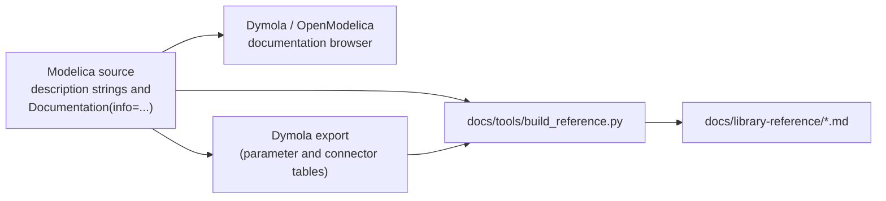

# Writing documentation

This page explains how models in OpenTEMPEST are documented, so that the documentation browser in Dymola or OpenModelica, the exported [library reference](library-reference/README.md) and the source code all read the same way. Follow it when you add or change a model.

## Where documentation lives

Every piece of model documentation is written in the Modelica source. The Markdown reference in `docs/library-reference` is generated from it, so never edit those pages by hand.



## Description strings

Every class (package, model, block, function, record, connector, type) and every parameter and connector gets a short description string. This is the one-line text shown in the package browser, in tooltips, in the parameter dialog and in the tables of the reference.

```modelica
model Stack1D "Stack of 1D co-flow cells with end plates and manifolds"
  parameter Integer Ncell(min=2) = 5 "Number of cells in the stack";
  parameter SI.Temperature TStart = 1023.15 "Uniform start temperature"
    annotation (Dialog(tab="Initialization"));
```

Rules:

- Start with a capital letter and leave out the full stop at the end.
- Say what the class is, as a noun phrase: "1D fuel channel with ...", not "This model calculates ...".
- Keep it under about 100 characters. Anything longer belongs in `Documentation(info=...)`.
- Do not repeat the unit in the text. The unit comes from the type (`SI.Length`, `SI.Temperature`, ...) and is shown automatically.
- Do not describe the implementation history ("added dp calculation ...") in the description. Use `Documentation(revisions=...)` for that.
- For media, list the species in the order of the mass fraction vector, for example `"Fuel gas as ideal gas mixture (H2, CH4, CO2, CO, H2O, N2)"`. Users need the order to index `X[i]` and `y[i]`.

## The info text

Longer documentation goes into `Documentation(info=...)` as simple HTML. Use this structure:

```modelica
annotation (Documentation(info="<html>
<p>One or two sentences on what the model represents and when to use it.</p>
<h4>Modelling assumptions</h4>
<ul>
<li>Ideal gas mixture, no axial diffusion.</li>
<li>Uniform pressure across the channel width.</li>
</ul>
<h4>Governing equations</h4>
<p>Mass balance per control volume: <code>dm/dt = sum(m_flow_in) - sum(m_flow_out) + r*MM</code></p>
<h4>References</h4>
<ul>
<li>F. Sedeqi et al. 2024, <a href=\"https://doi.org/10.1149/1945-7111/ad5e01\">doi:10.1149/1945-7111/ad5e01</a></li>
</ul>
</html>"));
```

Rules:

- Do not start with a title (`<h1>`, `<h2>`) that repeats the class name. The browser and the reference already show the name.
- Use `<h4>` for section headings. This is the convention of the Modelica Standard Library, and the reference turns them into `###` headings below the class heading.
- Common section names: *Modelling assumptions*, *Included phenomena*, *Governing equations*, *Discretisation*, *Usage*, *References*.
- Use `<code>` for variable names and short equations, `<pre>` for longer code examples, and `<ul>`/`<li>` for lists.
- Link to other classes with `modelica://` URIs, for example `<a href=\"modelica://OpenTEMPEST.SOC.Electrochem.Components.BV_Steam\">BV_Steam</a>`. These links work in the Modelica tools and are turned into links between the Markdown pages.
- Link papers with their DOI, `https://doi.org/...`.
- Remember to escape double quotes inside the string as `\"`.

## Updating the Markdown reference

The reference pages are built by `docs/tools/build_reference.py`. It takes the description strings and info texts from the source, and the parameter and connector tables (including inherited elements) from a Dymola documentation export.

After editing description strings or info texts:

```bash
python docs/tools/build_reference.py
python docs/tools/check_links.py
```

After adding or removing parameters, connectors or classes, make a fresh export first so that the tables are up to date:

1. Export the documentation of the `OpenTEMPEST` package from Dymola to Markdown into `docs/library-reference`, the same way the existing pages were made, overwriting them.
2. Run `python docs/tools/build_reference.py --import-export`. This stores the tables in `docs/library-reference/_export.json` and rewrites the pages.
3. Run `python docs/tools/check_links.py` to make sure no link is broken.

Both scripts only need Python 3, no extra packages.

[Return to main page](../README.md)
