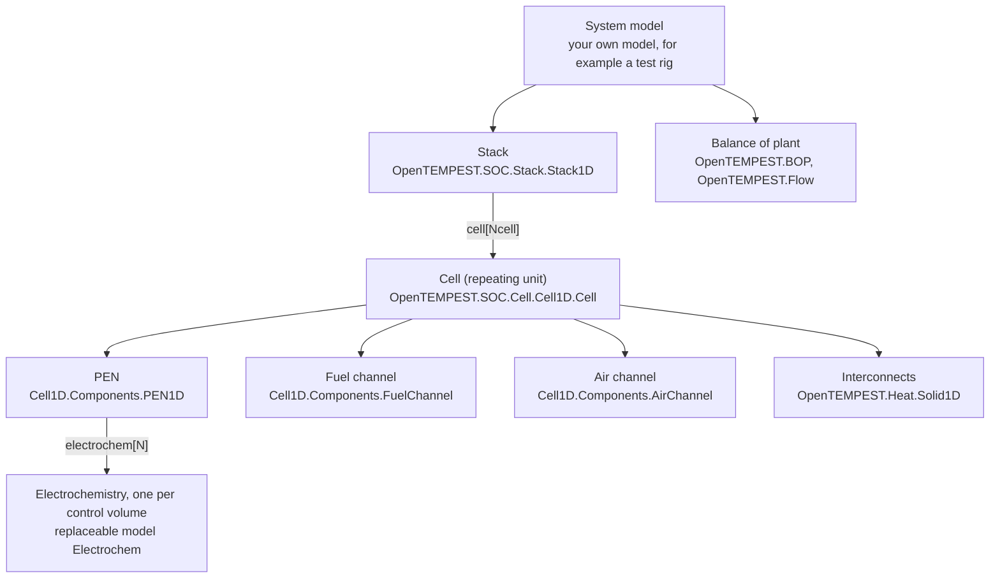
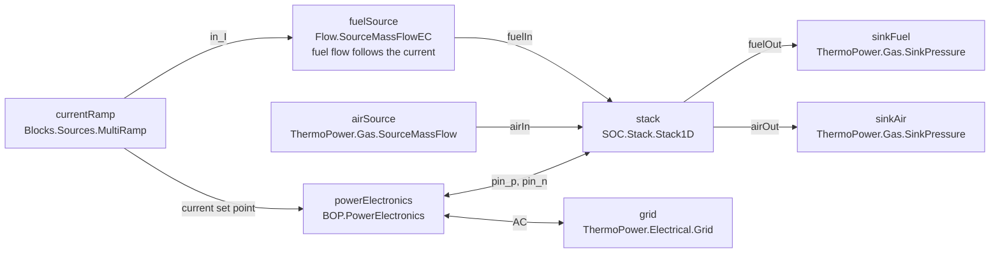
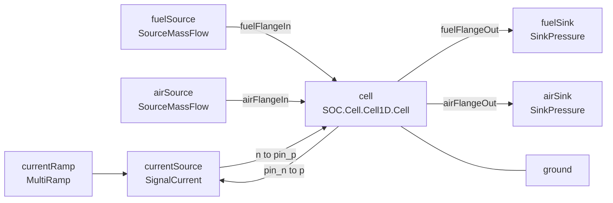
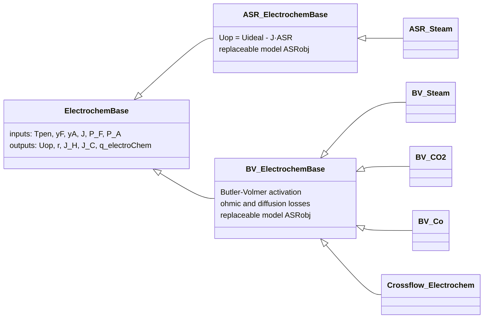
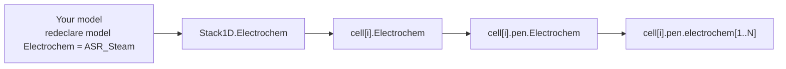
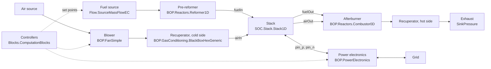

# User workflows

This page walks through the common ways of working with OpenTEMPEST, step by step. It is written for people who are new to Modelica, new to OpenTEMPEST, or both. If you have not installed the library yet, start with [Package installation and first steps](Installation.md). For the details of a single model, use the [library reference](library-reference/README.md).

**Contents**

1. [Modelica in ten minutes](#1-modelica-in-ten-minutes)
2. [Run an example model](#2-run-an-example-model)
3. [Build a cell test bench](#3-build-a-cell-test-bench)
4. [Run, initialise and analyse a simulation](#4-run-initialise-and-analyse-a-simulation)
5. [Change the electrochemistry (replaceable models)](#5-change-the-electrochemistry-replaceable-models)
6. [Work with stack models](#6-work-with-stack-models)
7. [Build a system model](#7-build-a-system-model)
8. [Edit and extend the library](#8-edit-and-extend-the-library)

> **Library version.** The code on this page matches the current release, which is built on the Modelica Standard Library (MSL) 3.2.3 and ThermoPower. The migration to MSL 4.x without ThermoPower changes a few names. See [After the MSL 4 migration](#after-the-msl-4-migration) at the end of this page.

---

## 1. Modelica in ten minutes

Modelica is an equation based, object oriented modelling language. You do not write the solution procedure. You write the equations of each component and connect the components, and the tool (Dymola, OpenModelica) sorts the equations and solves them over time. A handful of concepts is enough to use OpenTEMPEST.

| Concept | What it means | Where you see it in OpenTEMPEST |
|---|---|---|
| **Package** | A folder of classes, like a namespace. | `OpenTEMPEST.SOC.Stack` holds all stack models. |
| **Model** | A component with variables, parameters and equations. | `OpenTEMPEST.SOC.Cell.Cell1D.Cell` |
| **Parameter** | A value that is fixed during a simulation and set before it starts. | `Ncell`, `lX`, `TStart` |
| **Connector** | A port through which a model exchanges mass, energy or charge with other models. | Gas flanges `fuelIn`/`airIn`, electrical pins `pin_p`/`pin_n`, heat ports `dHT_*` |
| **`connect(a, b)`** | Joins two connectors: potentials (pressure, temperature, voltage) become equal and flows (mass flow, heat flow, current) sum to zero. | `connect(fuelSource.flange, stack.fuelIn);` |
| **`extends`** | Inheritance: a model takes over everything from a base class and adds to it. | `Stack1DTest` extends `Modelica.Icons.Example`, all electrochemistry models extend `ElectrochemBase`. |
| **`replaceable` / `redeclare`** | A placeholder for a sub-model that the user can swap for another compatible one. | The electrochemistry `Electrochem` in every cell and stack, the gas media `FCMedium`/`ACMedium`, the flux interpolation scheme `fluxInterp`. |
| **Modifier** | Changing parameters of a component where it is used, in brackets. | `Stack1D stack(Ncell=5, TStart=973.15)` |
| **`inner` / `outer`** | A global object that all components can see, declared once at the top level. | `inner ThermoPower.System system` holds global settings used by the gas sources and sinks. |

A model in a text editor looks like this. The graphical diagram in Dymola or OpenModelica is the same model drawn with icons, and the lines in the diagram are `connect` statements.

```modelica
model MyFirstModel "A short description of the model"
  parameter Real k = 2 "Gain";        // set before the simulation
  Real x(start = 1) "State";          // variable with a start value
equation
  der(x) = -k*x;                      // equations, not assignments
end MyFirstModel;
```

### How OpenTEMPEST is organised

OpenTEMPEST builds large models from small ones. A stack contains cells, a cell contains a PEN (positive electrode, electrolyte, negative electrode), gas channels and interconnects, and the PEN contains one electrochemistry object per control volume. Each level is a model you can use on its own. See [Framework structure](FrameworkStructure.md) for the physics behind each level.



The main packages are:

| Package | Contents |
|---|---|
| [`SOC.Electrochem`](library-reference/OpenTEMPEST_SOC_Electrochem.md) | Electrochemistry models and ASR correlations |
| [`SOC.Cell`](library-reference/OpenTEMPEST_SOC_Cell.md) | 1D co-flow and 2D cross-flow cell models and their components |
| [`SOC.Stack`](library-reference/OpenTEMPEST_SOC_Stack.md) | Stack models, from lumped (0D) to cross-flow with simplified cells |
| [`BOP`](library-reference/OpenTEMPEST_BOP.md) | Balance of plant: heat exchangers, heaters, compressors, fans, reformers, combustors |
| [`Flow`](library-reference/OpenTEMPEST_Flow.md) | Gas flow components: sources, splitters, manifolds, sensors |
| [`Heat`](library-reference/OpenTEMPEST_Heat.md) | Solids and heat transfer: conduction, convection, radiation |
| [`Medium`](library-reference/OpenTEMPEST_Medium.md) | Gas mixtures, for example `Fuel_CH4` (H2, CH4, CO2, CO, H2O, N2) and `Air_Medium` (O2, N2) |
| [`Examples`](library-reference/OpenTEMPEST_Examples.md) | Ready to run example models |

---

## 2. Run an example model

The quickest way to see the library working is to simulate one of the stack examples in `OpenTEMPEST.Examples.Stack`.

| Example | What it shows |
|---|---|
| `Stack0DTest` | Lumped stack `Stack0D`. Very fast, good for system studies. |
| `Stack1DTest` | Stack of 1D co-flow cells `Stack1D`, steam electrolysis with a current ramp. |
| `SimplifiedStackTest` | `SimplifiedStack1D`: a few detailed cells, the rest lumped into simplified blocks. |

`Stack1DTest` connects the stack to gas sources and sinks and to a current controlled power supply:



**In Dymola**

1. Load the libraries (see [Installation](Installation.md)).
2. In the package browser open `OpenTEMPEST > Examples > Stack > Stack1DTest`.
3. Switch to the *Simulation* tab and press *Simulate*. The stop time and solver are stored in the model (`experiment` annotation), so you do not need to set them.
4. In the variable browser, plot for example `stack.cell[3].pen.T` (PEN temperature along the cell), `stack.cell[3].pen.J` (current density) and `stack.cell[3].pen.Uop[1]` (cell voltage).

**In OpenModelica**

OpenTEMPEST is developed and tested in Dymola, so expect some warnings in OpenModelica. To try it, open `package.mo` of OpenTEMPEST and of its dependencies in OMEdit, or use a script:

```modelica
// run with: omc runExample.mos
loadModel(Modelica, {"3.2.3"});
loadFile("path/to/ThermoPower/package.mo");
loadFile("path/to/OpenTEMPEST/package.mo");
simulate(OpenTEMPEST.Examples.Stack.Stack1DTest);
getErrorString();
```

---

## 3. Build a cell test bench

Before you build a stack or a system, it is often useful to look at one cell with fixed boundary conditions, for example to compare with single cell measurements. There is no ready made cell example yet, so here is how to build one. The test bench needs:

- a fuel source and an air source (mass flow, temperature and composition),
- pressure sinks at the outlets,
- a current source with a ground, which sets the operating point,
- the cell itself.



### Step by step in the graphical editor

1. Create a new package for your own work, for example `MyProject` (*File > New > Package*). Keep your models out of the OpenTEMPEST package, see [section 8](#8-edit-and-extend-the-library).
2. Create a new model `MyProject.SingleCell1DTest`.
3. Drag the following components from the package browser into the diagram:
   - `OpenTEMPEST.SOC.Cell.Cell1D.Cell`
   - two `ThermoPower.Gas.SourceMassFlow` and two `ThermoPower.Gas.SinkPressure`
   - `Modelica.Electrical.Analog.Sources.SignalCurrent` and `Modelica.Electrical.Analog.Basic.Ground`
   - `OpenTEMPEST.Blocks.Sources.MultiRamp`
   - `ThermoPower.System` (it is declared `inner` automatically)
4. Double click each component and set its parameters. Set the medium of the gas sources and sinks (`Medium`) to `OpenTEMPEST.Medium.Fuel_CH4` on the fuel side and `OpenTEMPEST.Medium.Air_Medium` on the air side.
5. Draw the connections by dragging from one connector to the other.
6. Press *Check* (F8). The model must be balanced (as many equations as unknowns) before you can simulate it.

### The same model as code

You can paste this into a new model in Dymola's text view. The values are an example of steam electrolysis at 800 °C.

```modelica
within MyProject;
model SingleCell1DTest "Steam electrolysis with one 1D co-flow cell, adiabatic"
  extends Modelica.Icons.Example;
  import SI = Modelica.SIunits;

  parameter SI.Temperature T0 = 1073.15 "Gas inlet temperature and start temperature";
  parameter SI.AbsolutePressure p0 = 1e5 "Outlet pressure";

  inner ThermoPower.System system "Global settings used by the ThermoPower sources and sinks";

  // The cell. N is the number of control volumes along the flow direction.
  OpenTEMPEST.SOC.Cell.Cell1D.Cell cell(
    N=10,
    lX=0.1,
    lY=0.15,
    TStart=T0,
    Jstart=0,
    pStartAC=p0,
    pStartInFC=p0,
    redeclare model Electrochem = OpenTEMPEST.SOC.Electrochem.Components.BV_Steam);

  // Fuel side: 90 mol-% H2O, 10 mol-% H2.
  // Mass fractions in the order of Fuel_CH4: H2, CH4, CO2, CO, H2O, N2
  ThermoPower.Gas.SourceMassFlow fuelSource(
    redeclare package Medium = OpenTEMPEST.Medium.Fuel_CH4,
    w0=6e-6,
    p0=p0,
    T=T0,
    Xnom={0.01228, 1e-5, 1e-5, 1e-5, 0.98768, 1e-5});
  ThermoPower.Gas.SinkPressure fuelSink(
    redeclare package Medium = OpenTEMPEST.Medium.Fuel_CH4,
    p0=p0);

  // Air side, mass fractions O2, N2
  ThermoPower.Gas.SourceMassFlow airSource(
    redeclare package Medium = OpenTEMPEST.Medium.Air_Medium,
    w0=4.3e-4,
    p0=p0,
    T=T0);
  ThermoPower.Gas.SinkPressure airSink(
    redeclare package Medium = OpenTEMPEST.Medium.Air_Medium,
    p0=p0);

  // Electrical load: three current steps of -15 A (electrolysis)
  Modelica.Electrical.Analog.Sources.SignalCurrent currentSource;
  Modelica.Electrical.Analog.Basic.Ground ground;
  OpenTEMPEST.Blocks.Sources.MultiRamp currentRamp(
    n=3,
    height=fill(-15, 3),
    duration=fill(500, 3),
    startTime={1000, 3000, 5000});

equation
  connect(fuelSource.flange, cell.fuelFlangeIn);
  connect(cell.fuelFlangeOut, fuelSink.flange);
  connect(airSource.flange, cell.airFlangeIn);
  connect(cell.airFlangeOut, airSink.flange);

  connect(currentSource.n, cell.pin_p);
  connect(currentSource.p, cell.pin_n);
  connect(cell.pin_n, ground.p);
  connect(currentRamp.y, currentSource.i);

  annotation (experiment(StopTime=8000, __Dymola_Algorithm="Cvode"));
end SingleCell1DTest;
```

Notes:

- **Sign convention.** The current density `J` is positive in fuel cell (SOFC) mode and negative in electrolysis (SOEC) mode. With the current source connected as above, the cell current equals the source signal, so the negative ramp drives electrolysis, as in `Stack1DTest`.
- **Mass flows.** The fuel flow is chosen so that about 75 % of the steam is converted at the final current of -45 A. Faraday's law gives the steam consumption: `I/(2*F)*M_H2O = 45/(2*96485)*0.018 = 4.2e-6 kg/s`.
- **Heat ports.** Heat ports that are not connected are adiabatic. To put the cell in a furnace, connect `cell.dHT_z0` and `cell.dHT_z1` to an [`OpenTEMPEST.Heat.PrescribedTemperature1D`](library-reference/OpenTEMPEST_Heat.md#prescribedtemperature1d) with `N` equal to the number of control volumes.
- **The diagram annotation is optional.** A model written as text has no icons placed in the diagram. Dymola places them when you open the diagram, and you can move them around.

---

## 4. Run, initialise and analyse a simulation

### Simulation settings

| Setting | Recommendation |
|---|---|
| Solver | `Cvode` or `Dassl`. The models are stiff (fast gas dynamics, slow solid temperatures). |
| Tolerance | `1e-6` is a good default. Loosen to `1e-4` for long system simulations. |
| Stop time | Thermal transients of a stack take minutes to hours. The stack examples run for 100000 s. |
| Output interval | Set a number of intervals (for example 5000) instead of storing every step. |

Store the settings in the model with an `experiment` annotation, as in the examples, so that everyone runs the model the same way.

### Initialisation

Most problems with new models appear at the start of the simulation. Some practical rules:

- **Start values.** Every cell and stack has an *Initialization* tab. Set `TStart` close to the gas inlet temperatures and `pStart...` close to the operating pressure. Bad start values are the most common cause of failed initialisation.
- **Start at zero current.** Set `Jstart=0` and let the current ramp up after the temperatures have settled, as the examples do (the first step starts after 20000 s in `Stack1DTest`).
- **Ramps instead of steps.** A step in current or flow is a hard test for the solver. Use `MultiRamp` with a non-zero `duration`.
- **Read the log.** When initialisation fails, Dymola's translation log names the variables involved. Check their start values first.

### Analysing the results

- Plot variables from the variable browser. The most useful ones in a cell are in the PEN: `pen.T` (temperature), `pen.J` (current density), `pen.Uop` (voltage) and `pen.Icell` (total current). In a stack, prefix them with the cell, for example `stack.cell[1].pen.T`.
- Arrays such as `pen.T[1:N]` hold one value per control volume along the flow direction. Plot all elements together to see how the profile develops, or compare the first and last element for the gradient along the cell.
- For repeated runs, write a script (`.mos` file):

```modelica
// parameter sweep over the number of cells
for n in {5, 10, 20} loop
  simulateModel("OpenTEMPEST.Examples.Stack.Stack1DTest(Ncell=" + String(n) + ")",
                stopTime=100000, method="Cvode",
                resultFile="Stack1DTest_N" + String(n));
end for;
```

---

## 5. Change the electrochemistry (replaceable models)

The electrochemistry describes the voltage and the reaction rates of the cell as a function of temperature, gas composition, pressure and current density. It is a *replaceable* model, so you can choose a different one without changing the cell or stack model.

### Available models



| Model | Use it for |
|---|---|
| [`ASR_Steam`](library-reference/OpenTEMPEST_SOC_Electrochem_Components.md#asr_steam) | Lumped model: Nernst voltage minus `J*ASR(T)`. Needs only an ASR fit of measured U-i curves. |
| [`BV_Steam`](library-reference/OpenTEMPEST_SOC_Electrochem_Components.md#bv_steam) | Detailed model for H2/H2O: Butler-Volmer activation, ohmic and diffusion overpotentials. |
| [`BV_CO2`](library-reference/OpenTEMPEST_SOC_Electrochem_Components.md#bv_co2) | Detailed model for CO/CO2. |
| [`BV_Co`](library-reference/OpenTEMPEST_SOC_Electrochem_Components.md#bv_co) | Detailed model for co-electrolysis of H2O and CO2. |
| [`Crossflow_Electrochem`](library-reference/OpenTEMPEST_SOC_Electrochem_Components.md#crossflow_electrochem) | `BV_Steam` with the parameters used for the cross-flow cell. |

The ASR itself is a second replaceable model inside the electrochemistry, chosen from [`SOC.Electrochem.ASR`](library-reference/OpenTEMPEST_SOC_Electrochem_ASR.md): `ASR_log`, `ASR_Exponential`, `ASR_Linear` or the ohmic `ASR_Ohm_ESC`.

### How the choice is passed down

You choose the electrochemistry once, at the level you work on. Each level passes it on to the level below with `redeclare model Electrochem = Electrochem`:



### Choosing a model in the graphical editor

Double click the stack or cell, open the tab with the `Electrochem` parameter and pick a model from the drop down list. Dymola writes the `redeclare` for you.

### Choosing a model in code

```modelica
// detailed steam electrolysis model with its default parameters
OpenTEMPEST.SOC.Stack.Stack1D stack(
  Ncell=5,
  redeclare model Electrochem = OpenTEMPEST.SOC.Electrochem.Components.BV_Steam);

// lumped model with your own ASR fit: ASR/(Ohm.cm2) = A*exp(B*(T - 273.15))
OpenTEMPEST.SOC.Stack.Stack1D stack(
  Ncell=5,
  redeclare model Electrochem = OpenTEMPEST.SOC.Electrochem.Components.ASR_Steam(
    redeclare model ASRobj = OpenTEMPEST.SOC.Electrochem.ASR.ASR_Exponential(A=728, B=-8.29e-3)));

// change parameters of the detailed model, for example the degradation of the ohmic resistance
OpenTEMPEST.SOC.Stack.Stack1D stack(
  Ncell=5,
  redeclare model Electrochem = OpenTEMPEST.SOC.Electrochem.Components.BV_Steam(
    ASROhmDegrationRate=10, alphaFE=0.45));
```

### Writing your own ASR correlation

If your measured ASR follows a different law, write a new ASR model. Extend [`ASR_Base`](library-reference/OpenTEMPEST_SOC_Electrochem_ASR.md#asr_base), which gives you the input `Tpen`, the output `ASR` (in Ohm.m², note the conversion from Ohm.cm²) and two parameters `A` and `B`. The template `ASR_T_Template` contains the same instructions.

```modelica
within MyProject;
model ASR_Arrhenius "Arrhenius ASR correlation, ASR = A*exp(B/T)"
  extends OpenTEMPEST.SOC.Electrochem.ASR.ASR_Base;
equation
  ASR = A*exp(B/Tpen);   // A in Ohm.m2, B in K
end ASR_Arrhenius;
```

Use it like the built-in correlations (the values are only an illustration, about 0.34 Ohm.cm² at 800 °C):

```modelica
redeclare model Electrochem = OpenTEMPEST.SOC.Electrochem.Components.ASR_Steam(
  redeclare model ASRobj = MyProject.ASR_Arrhenius(A=3e-9, B=1e4))
```

### Writing your own electrochemistry model

A new electrochemistry model extends [`ElectrochemBase`](library-reference/OpenTEMPEST_SOC_Electrochem_Components.md#electrochembase). The PEN gives it the inputs `Tpen`, `yF`, `yA` (mole fractions on the fuel and air side), `J`, `P_F` and `P_A`, and sets `Uop` from the cell voltage. Your model must provide equations for:

| Variable | Meaning |
|---|---|
| `Uop` | Voltage balance: how the cell voltage relates to the current density |
| `r` | Electrochemical reaction rate in mol/(m².s), usually `J/(2*F)` |
| `J_H`, `J_C` | Share of the current density going to the H2/H2O and CO/CO2 reactions |
| `q_electroChem` | Heat flux released by the reaction, `-r*dHr` |

A minimal example with a constant open circuit voltage and ASR:

```modelica
within MyProject;
model LinearElectrochem "Constant open circuit voltage and ASR for H2/H2O (teaching example)"
  extends OpenTEMPEST.SOC.Electrochem.Components.ElectrochemBase;
  import SI = Modelica.SIunits;
  parameter SI.Voltage U0 = 0.95 "Open circuit voltage";
  parameter OpenTEMPEST.Units.AreaSpecificResistance ASR = 0.3e-4 "Area specific resistance";
  parameter SI.MolarEnthalpy dHr = -248e3 "Reaction enthalpy of H2 + 1/2 O2 -> H2O";
equation
  Uop = U0 - J*ASR;                    // J > 0: fuel cell mode
  r = J/(2*Modelica.Constants.F);      // Faraday's law
  J_H = J;                             // all current goes to the H2/H2O reaction
  J_C = 0;                             // no CO/CO2 reaction
  q_electroChem = -r*dHr;              // reaction heat
end LinearElectrochem;
```

The species index in `yF` follows the medium: in `Fuel_CH4` it is H2, CH4, CO2, CO, H2O, N2, so `yF[1]` is H2 and `yF[5]` is H2O. In `Air_Medium`, `yA[1]` is O2.

---

## 6. Work with stack models

A stack model contains the cells, the end plates and the gas distribution. Choose the model by the question you want to answer:

| Model | Cells | Use it for |
|---|---|---|
| [`Stack0D`](library-reference/OpenTEMPEST_SOC_Stack.md#stack0d) | One lumped temperature, ASR electrochemistry | System studies, control design, long simulations |
| [`Stack1D`](library-reference/OpenTEMPEST_SOC_Stack.md#stack1d) | `Ncell` 1D co-flow cells | Temperature and current distribution along the flow and over the stack height |
| [`SimplifiedStack1D`](library-reference/OpenTEMPEST_SOC_Stack.md#simplifiedstack1d) | A few detailed 1D cells, the rest as simplified blocks | Large stacks with less computation |
| [`StackCF`](library-reference/OpenTEMPEST_SOC_Stack.md#stackcf) | `Ncell` 2D cross-flow cells | Cross-flow stacks, 2D temperature fields |
| [`StackCFSimpCell`](library-reference/OpenTEMPEST_SOC_Stack.md#stackcfsimpcell) | Cross-flow cells with 1D channels | Cross-flow stacks with less computation |
| [`SimplifiedStackCF`](library-reference/OpenTEMPEST_SOC_Stack.md#simplifiedstackcf) | A few detailed cross-flow cells, the rest simplified | Large cross-flow stacks |

The simplification approach behind the simplified stacks is described in M. Tomberg et al. 2022, *J. Electrochem. Soc.* 169 054530.

All stacks have the same kind of connectors: gas inlets and outlets (`fuelIn`, `airIn`, `fuelOut`, `airOut`; the cross-flow stack calls the air outlet `airout`; `Stack0D` uses `fuelInlet`, `airInlet`, ...), electrical pins and heat ports on the outer surfaces. To use a stack:

1. Set the geometry and the number of cells in the *General* and dimension tabs.
2. Choose the electrochemistry ([section 5](#5-change-the-electrochemistry-replaceable-models)) and the media.
3. Set the start values in the *Initialization* tab.
4. Connect gas sources and sinks, a current source or `BOP.PowerElectronics`, and, if you need heat losses, the heat ports (for example to an insulation model or a `PrescribedTemperature1D`). Unconnected heat ports are adiabatic.

---

## 7. Build a system model

A system model combines stacks with balance of plant (BoP) components into a test rig or a plant. The BoP models in [`OpenTEMPEST.BOP`](library-reference/OpenTEMPEST_BOP.md) and [`OpenTEMPEST.Flow`](library-reference/OpenTEMPEST_Flow.md) use the same gas connectors as the stacks, so they connect directly.

As an example, a simple SOFC system with air preheating and an afterburner:



Work in small steps:

1. **Start from a working stack example.** Copy `Stack1DTest` into your own package (see [section 8](#8-edit-and-extend-the-library)) and make sure it simulates.
2. **Add one component at a time** and simulate after each one. If the model fails, you know which component caused it.
3. **Check the media.** Every gas connection must use the same medium on both sides. The afterburner [`Combustor0D`](library-reference/OpenTEMPEST_BOP_Reactors.md#combustor0d) takes air (`Air_Medium`) and fuel (`Fuel_CH4`) and gives an exhaust (`SimpleExhaust`). The two sides of a heat exchanger have their own media (`MediumA`, `MediumB`).
4. **Close the loops last.** Recirculation and recuperation loops create algebraic loops and make initialisation harder. Add them when the open system runs, and give good start values to the components in the loop.
5. **Add controllers.** Blocks for set points and control (PID with variable limits, bumpless transfer, fuel flow control) are in [`Blocks.ComputationBlocks`](library-reference/OpenTEMPEST_Blocks_ComputationBlocks.md).

The structure of the system above in code. Parameters are left out (`...`), so this is a skeleton to fill in, not a model that runs as it is:

```modelica
within MyProject;
model SOFCSystem "SOFC system with recuperator and afterburner (skeleton)"
  inner ThermoPower.System system;

  OpenTEMPEST.SOC.Stack.Stack1D stack(Ncell=30, ...);
  OpenTEMPEST.Flow.SourceMassFlowEC fuelSource(nCells=30, use_in_I=true, ...);
  OpenTEMPEST.BOP.Reactors.Reformer1D preReformer(...);
  OpenTEMPEST.BOP.FanSimple blower(redeclare package Medium = OpenTEMPEST.Medium.Air_Medium, ...);
  OpenTEMPEST.BOP.GasConditioning.BlackBoxHexGeneric recuperator(
    redeclare package MediumA = OpenTEMPEST.Medium.Air_Medium,       // cold side
    redeclare package MediumB = OpenTEMPEST.Medium.SimpleExhaust,    // hot side
    ...);
  OpenTEMPEST.BOP.Reactors.Combustor0D afterburner(V=..., ...);
  OpenTEMPEST.BOP.PowerElectronics powerElectronics(nChannels=1, ...);
  ...
equation
  connect(fuelSource.flange, preReformer.infl);
  connect(preReformer.outfl, stack.fuelIn);
  connect(blower.fl_outlet, recuperator.inletA);
  connect(recuperator.outletA, stack.airIn);
  connect(stack.fuelOut, afterburner.inf);
  connect(stack.airOut, afterburner.ina);
  connect(afterburner.out, recuperator.inletB);
  connect(powerElectronics.pinN[1], stack.pin_p);
  connect(powerElectronics.pinP[1], stack.pin_n);
  ...
end SOFCSystem;
```

Published system studies made with OpenTEMPEST are listed on the [main page](../README.md#list-of-publications).

---

## 8. Edit and extend the library

### Keep your models in your own package

Do not change models inside the OpenTEMPEST package for a project. Updates of the library would overwrite your changes, and others could not reproduce your results. Create your own package next to it instead:

```
MyProject/
  package.mo          within; package MyProject ... end MyProject;
  package.order
  SingleCell1DTest.mo within MyProject; model SingleCell1DTest ...
  ASR_Arrhenius.mo
```

Load it after OpenTEMPEST. Models in `MyProject` can use everything in OpenTEMPEST by its full name.

### Three ways to change a model

| You want to | Do this | Example |
|---|---|---|
| Use a model with other parameters | Set modifiers where you use it | `OpenTEMPEST.SOC.Stack.Stack1D stack(Ncell=10, lX=0.12);` |
| Make a variant you reuse often | `extends` the model with modifiers, and add components or equations | see below |
| Change the equations of a model | Duplicate it into your package (Dymola: right click > *Duplicate Class*) and edit the copy | your own `MyProject.FuelChannelWithCoking` |

A variant made with `extends` keeps up with updates of the original:

```modelica
within MyProject;
model MyStack "Our 30-cell stack with the lumped ASR model"
  extends OpenTEMPEST.SOC.Stack.Stack1D(
    Ncell=30,
    lX=0.1,
    lY=0.1,
    redeclare model Electrochem = OpenTEMPEST.SOC.Electrochem.Components.ASR_Steam(
      redeclare model ASRobj = OpenTEMPEST.SOC.Electrochem.ASR.ASR_log(A=6000, B=7)));

  // additional output: mean PEN temperature of the middle cell
  Modelica.SIunits.Temperature TPenMean = sum(cell[integer(Ncell/2)].pen.T)/N;
end MyStack;
```

### Contributing changes to OpenTEMPEST

If you improve a model or add a new one that others can use:

1. Make the change on a branch of your fork.
2. Give every new class and parameter a description string and the model an info text, following [Writing documentation](DocumentationStyle.md).
3. Check the model and run the examples that use it.
4. Update the [library reference](library-reference/README.md) with `docs/tools/build_reference.py`.
5. Open a merge request on [Codeberg](https://codeberg.org/DLR-TT-ESI-EHT/OpenTEMPEST).

---

## After the MSL 4 migration

OpenTEMPEST is being moved to the Modelica Standard Library 4.x and its own interfaces, without ThermoPower. When that is released, change the code on this page as follows:

| Current release | After the migration |
|---|---|
| `import SI = Modelica.SIunits;` | `import SI = Modelica.Units.SI;` |
| `inner ThermoPower.System system;` | `inner OpenTEMPEST.System system;` (required in every top-level model) |
| `ThermoPower.Gas.SourceMassFlow`, `ThermoPower.Gas.SinkPressure` | `OpenTEMPEST.Flow.SourceMassFlow`, `OpenTEMPEST.Flow.SinkPressure` |
| `ThermoPower.Electrical.Grid` | `OpenTEMPEST.Electrical.Grid` |
| Gas connectors `ThermoPower.Gas.FlangeA`/`FlangeB` | `OpenTEMPEST.Interfaces.GasFlangeA`/`GasFlangeB` |

The workflows themselves do not change.

[Return to main page](../README.md)
