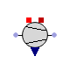
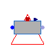
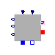

<!-- Generated by docs/tools/build_reference.py. Do not edit: change the Modelica source and re-run the script. -->

[Library reference](README.md) › [OpenTEMPEST](OpenTEMPEST.md) › **BOP**

# OpenTEMPEST.BOP

*Balance-of-plant components: compressors, fans, heat exchangers, heaters and reactors*

| | Class | Kind | Description |
|---|---|---|---|
|  | [FanSimple](#fansimple) | model | Simple fan/blower with prescribed mass flow and polytropic efficiency |
|  | [Compressor](#compressor) | model | Gas compressor with polytropic, mechanical and electrical efficiencies |
|  | [Evaporator](#evaporator) | model | Drum evaporator producing steam for a gas phase medium (under construction) |
|  | [Vaporizer](#vaporizer) | model | Vaporizer converting a liquid water mass flow into water vapour in a gas mixture |
|  | [PowerElectronics](#powerelectronics) | model | Power electronics unit with AC/DC conversion losses and current or voltage control |
|  | [PumpSimple](#pumpsimple) | model | Simple pump model for incompressible fluids |
|  | [GasConditioning](OpenTEMPEST_BOP_GasConditioning.md) | package | Heat exchangers, heaters, separators and gas conditioning components |
|  | [Reactors](OpenTEMPEST_BOP_Reactors.md) | package | Chemical reactors: combustors, reformers and methanol synthesis |

---

## FanSimple

`model OpenTEMPEST.BOP.FanSimple`

*Simple fan/blower with prescribed mass flow and polytropic efficiency*

Extends from ThermoPower.Icons.Gas.Fan.

**Parameters**

| Name | Description | Unit |
|---|---|---|
| `Medium` | *replaceable package*: Medium model |  |
| `eta` | Polytropic efficency |  |
| `allowFlowReversal` | = true to allow flow reversal, false restricts to design direction |  |
| **Initialisation** | | |
| `hStart` | Fluid Specific Enthalpy Start Value | `J/kg` |

**Connectors**

| Name | Description | Unit |
|---|---|---|
| `fl_inlet` | `ThermoPower.Gas.FlangeA` |  |
| `fl_outlet` | `ThermoPower.Gas.FlangeB` |  |
| `in_mf` | `Modelica.Blocks.Interfaces.RealInput` |  |
| `powerConnection` | `ThermoPower.Electrical.PowerConnection` |  |

[Back to top](#opentempestbop)

---

## Compressor

`model OpenTEMPEST.BOP.Compressor`

*Gas compressor with polytropic, mechanical and electrical efficiencies*

**Parameters**

| Name | Description | Unit |
|---|---|---|
| `eta` | Polytropic efficiency |  |
| `etaM` | Mechanical efficiency |  |
| `etaE` | Electrical efficiency |  |
| `Medium` | *replaceable package*: Medium model |  |

**Connectors**

| Name | Description | Unit |
|---|---|---|
| `inlet` | `ThermoPower.Gas.FlangeA` |  |
| `outlet` | `ThermoPower.Gas.FlangeB` |  |
| `powerConnection` | `ThermoPower.Electrical.PowerConnection` |  |
| `heatLosses` | `ThermoPower.Thermal.HT` |  |
| `Pi` | Pressure ratio |  |

[Back to top](#opentempestbop)

---

## Evaporator

`model OpenTEMPEST.BOP.Evaporator`

*Drum evaporator producing steam for a gas phase medium (under construction)*

Extends from Modelica.Icons.UnderConstruction (Icon for classes that are still under construction).

**Parameters**

| Name | Description | Unit |
|---|---|---|
| `gasPhaseMedium` | *replaceable package* |  |
| `Vd` | Drum internal volume | `m3` |
| `Mm` | Drum metal mass | `kg` |
| `cm` | Specific heat capacity of the drum's metal | `J/(kg.K)` |
| `Kv` | Nominal hydraulic conductance of the control valve | `(kg/s)/Pa` |
| **Initialisation** | | |
| `pStart` | Pressure start value | `Pa` |
| `VlStart` | Start value of drum water volume | `m3` |

**Connectors**

| Name | Description | Unit |
|---|---|---|
| `inlet` | `ThermoPower.Water.FlangeA` |  |
| `outlet` | `ThermoPower.Gas.FlangeB` |  |
| `hT` | `ThermoPower.Thermal.HT` |  |
| `controlValvePosition` | `Modelica.Blocks.Interfaces.RealInput` |  |

[Back to top](#opentempestbop)

---

## Vaporizer

`model OpenTEMPEST.BOP.Vaporizer`

*Vaporizer converting a liquid water mass flow into water vapour in a gas mixture*

**Parameters**

| Name | Description | Unit |
|---|---|---|
| `thermalInput` |  |  |
| `pStart` |  | `Pa` |
| `MediumInput` | *replaceable package* |  |
| `MediumOutput` | *replaceable package* |  |
| `mfNom` | Massflowrate | `kg/s` |

**Connectors**

| Name | Description | Unit |
|---|---|---|
| `waterInlet` | `ThermoPower.Water.FlangeA` |  |
| `gasOutlet1` | `ThermoPower.Gas.FlangeB` |  |
| `port` | `ThermoPower.Electrical.PowerConnection` |  |
| `dHTVolumes` | `ThermoPower.Thermal.DHTVolumes` |  |

[Back to top](#opentempestbop)

---

## PowerElectronics

`model OpenTEMPEST.BOP.PowerElectronics`

*Power electronics unit with AC/DC conversion losses and current or voltage control*

**Parameters**

| Name | Description | Unit |
|---|---|---|
| `nChannels` | Number of parallel electrical channels |  |
| `currentFactor` | Liniar factor, which is multiplied with the input current |  |
| `aLoss` | Parameter for AC/DC loss and aux power calculation of power; form: a \* x^2 + b\*x + c |  |
| `bLoss` |  |  |
| `cLoss` |  |  |
| `desginPower` | Desgin power for AC/DC loss and aux power calculation per channel |  |
| `useVoltageInput` | Use a voltage set value instead a current set value |  |
| `nCells` | Number of total cells attached (only for UAvg calc) |  |

**Connectors**

| Name | Description | Unit |
|---|---|---|
| `currentInput[nChannels]` | The set current | `A` |
| `pinN[nChannels]` | Negative pins |  |
| `pinP[nChannels]` | Positives pins |  |
| `sensors` | Sensor bus |  |
| `gridConnectionAC` | AC grid connection |  |
| `voltageInput[nChannels]` | The set voltage |  |
| `PDC` | DC power | `W` |
| `PAC` | AC power | `W` |
| `UAvg` | Average cell voltage | `V` |

[Back to top](#opentempestbop)

---

## PumpSimple

`model OpenTEMPEST.BOP.PumpSimple`

*Simple pump model for incompressible fluids*

Model for a simple pump, based on assumption:

1.  incompressible fluid (d`rho<\code>/d`p = 0)  
2. no internal Volume in pump
3. adiabatic pump

P = mf (h2 - h1)   
eta_isen= dh_isen/dh_poly, with h_isen = vdp   
P= mf * dh_poly = mf * dh_isen/eta_isen = mf *vdp/eta_isen  
--> resource image with equations to be inserted

Extends from ThermoPower.Icons.Water.Pump.

**Parameters**

| Name | Description | Unit |
|---|---|---|
| `Medium` | *replaceable package*: Medium model |  |
| `eta_isen` | isentropic efficency |  |
| `eta_el` | electrical efficency |  |
| `eta_mech` | mechanical efficency |  |
| `allowFlowReversal` | = true to allow flow reversal, false restricts to design direction |  |
| **Initialisation** | | |
| `hStart` | Fluid Specific Enthalpy Start Value | `J/kg` |

**Connectors**

| Name | Description | Unit |
|---|---|---|
| `fl_inlet` | `ThermoPower.Water.FlangeA` |  |
| `fl_outlet` | `ThermoPower.Water.FlangeB` |  |
| `in_mf` | `Modelica.Blocks.Interfaces.RealInput` |  |
| `powerConnection` | `ThermoPower.Electrical.PowerConnection` |  |

[Back to top](#opentempestbop)
