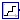
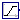
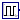
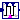
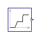
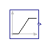
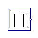
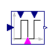

<!-- Generated by docs/tools/build_reference.py. Do not edit: change the Modelica source and re-run the script. -->

[Library reference](README.md) › [OpenTEMPEST](OpenTEMPEST.md) › [Blocks](OpenTEMPEST_Blocks.md) › **Sources**

# OpenTEMPEST.Blocks.Sources

*Signal sources*

| | Class | Kind | Description |
|---|---|---|---|
|  | [MultiRamp](#multiramp) | model | Sum of n ramps, for example a stepwise load profile |
|  | [VectorRamp](#vectorramp) | block | Vector of ramp signals with individual offsets and targets |
|  | [Pulse](#pulse) | model | Pulse train built from ramps (faster than the MSL pulse source) |
|  | [PulseVar](#pulsevar) | model | Pulse wave with amplitude, period and duty cycle given as inputs |
|  | [RealExpressionArray](#realexpressionarray) | block | Set output signal to a time varying Real expression |

---

## MultiRamp

`model OpenTEMPEST.Blocks.Sources.MultiRamp`

*Sum of n ramps, for example a stepwise load profile*

The output `y` is the sum of `n` ramps added to `offset`. Ramp `i` starts at `startTime[i]`, lasts `duration[i]` and changes the output by `height[i]`. A duration of 0 gives a step.

Useful for load profiles, for example a current that is increased in several steps.

Extends from Modelica.Blocks.Interfaces.SO (Single Output continuous control block).

**Parameters**

| Name | Description | Unit |
|---|---|---|
| `n` | number of ramps |  |
| `height[n]` | Height of ramps |  |
| `duration[n]` | Duration of ramp (= 0.0 gives a Step) | `s` |
| `offset` | Offset of output signal |  |
| `startTime[n]` | Output = offset for time \< startTime | `s` |

**Connectors**

| Name | Description | Unit |
|---|---|---|
| `y` | Connector of Real output signal |  |

[Back to top](#opentempestblockssources)

---

## VectorRamp

`block OpenTEMPEST.Blocks.Sources.VectorRamp`

*Vector of ramp signals with individual offsets and targets*

Extends from Modelica.Blocks.Interfaces.MO (Multiple Output continuous control block).

**Parameters**

| Name | Description | Unit |
|---|---|---|
| `height[nout]` | Height of ramps |  |
| `target[nout]` | Target of the output signals |  |
| `duration` | Duration of ramp (= 0.0 gives a Step) | `s` |
| `offset[nout]` | Offset of output signals |  |
| `startTime` | Output = offset for time \< startTime | `s` |
| `nout` | Number of outputs |  |

**Connectors**

| Name | Description | Unit |
|---|---|---|
| `y[nout]` | Connector of Real output signals |  |

[Back to top](#opentempestblockssources)

---

## Pulse

`model OpenTEMPEST.Blocks.Sources.Pulse`

*Pulse train built from ramps (faster than the MSL pulse source)*

Generates `nPulse` pulses of height `pulseHeight` starting at `startPulse`. Each period lasts `pulseDuration`, of which the fraction `dutyCycle` is on. The pulses are built from steps (ramps with zero duration), which is faster to simulate than the MSL pulse source.

Extends from Modelica.Blocks.Interfaces.SO (Single Output continuous control block).

**Parameters**

| Name | Description | Unit |
|---|---|---|
| `nPulse` | Number of Pulses |  |
| `pulseHeight` | Height of Pulse |  |
| `startPulse` |  | `s` |
| `pulseDuration` | Time for one period (onTime + offtime) | `s` |
| `dutyCycle` | Width of Pulse (0 to 1) |  |
| `offset` | Offset of output signal |  |

[Back to top](#opentempestblockssources)

---

## PulseVar

`model OpenTEMPEST.Blocks.Sources.PulseVar`

*Pulse wave with amplitude, period and duty cycle given as inputs*

**Connectors**

| Name | Description | Unit |
|---|---|---|
| `y` | `Modelica.Blocks.Interfaces.RealOutput` |  |
| `duration` | `Modelica.Blocks.Interfaces.RealInput` |  |
| `duty` | `Modelica.Blocks.Interfaces.RealInput` |  |
| `Amplitude` | `Modelica.Blocks.Interfaces.RealInput` |  |
| `pulseOn` | `Modelica.Blocks.Interfaces.BooleanInput` |  |

[Back to top](#opentempestblockssources)

---

## RealExpressionArray

`block OpenTEMPEST.Blocks.Sources.RealExpressionArray`

*Set output signal to a time varying Real expression*

The (time varying) Real output signal of this block can be defined in its parameter menu via variable **y**. The purpose is to support the easy definition of Real expressions in a block diagram. For example, in the y-menu the definition "if time < 1 then 0 else 1" can be given in order to define that the output signal is one, if time ≥ 1 and otherwise it is zero. Note, that "time" is a built-in variable that is always accessible and represents the "model time" and that variable **y** is both a variable and a connector.

**Parameters**

| Name | Description | Unit |
|---|---|---|
| `nAxes` | number of axes of output array y |  |
| `arrayOut[nAxes]` | shape of output array y |  |
| **Time varying output signal** | | |
| `y[arrayOut[1], arrayOut[2], arrayOut[3], arrayOut[4]]` | Values of Real output array y |  |

**Connectors**

| Name | Description | Unit |
|---|---|---|
| **Time varying output signal** | | |
| `y[arrayOut[1], arrayOut[2], arrayOut[3], arrayOut[4]]` | Values of Real output array y |  |

[Back to top](#opentempestblockssources)
