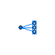
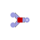
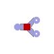
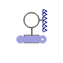
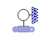
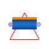
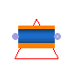
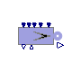
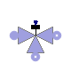

<!-- Generated by docs/tools/build_reference.py. Do not edit: change the Modelica source and re-run the script. -->

[Library reference](README.md) › [OpenTEMPEST](OpenTEMPEST.md) › **Flow**

# OpenTEMPEST.Flow

*Gas flow components: 1D flow models, splitters, joiners, manifolds, sources and sensors*

| | Class | Kind | Description |
|---|---|---|---|
|  | [Manifold_out](#manifold_out) | model | Manifold collecting n inlet ports into one outlet |
|  | [Manifold](#manifold) | model | Manifold distributing one inlet flow evenly over n outlet ports |
|  | [FluxInterpolators](OpenTEMPEST_Flow_FluxInterpolators.md) | package | Differencing schemes for interpolating fluxes at control volume faces |
|  | [BaseClasses](OpenTEMPEST_Flow_BaseClasses.md) | package | Base classes for flow models |
|  | [gasHeaterAndJoiner](#gasheaterandjoiner) | model | Flow joiner with convective heat transfer in the inlet and outlet ducts |
|  | [MultiSplitter](#multisplitter) | model | Split one gas flow into n outlets |
|  | [ForcedFlowMultiSplitter](#forcedflowmultisplitter) | model | Splitter forcing an equal mass flow into each of n outlets |
|  | [MultiJoin](#multijoin) | model | Join n gas flows into one outlet |
|  | [GasHeatedSplitter](#gasheatedsplitter) | model | Flow splitter with convective heat transfer in the inlet and outlet ducts |
|  | [SensGasFlow](#sensgasflow) | model | Sensor for mass flow and composition of a gas flow |
|  | [SensGasProperty](#sensgasproperty) | model | Sensor for gas properties (cp, lambda, viscosity, temperature, density) |
|  | [LambdaSensor](#lambdasensor) | model | Sensor for the air-fuel equivalence ratio (lambda) of a fuel and an air flow |
|  | [Flow1D](#flow1d) | model | 1D finite volume gas flow model with a distributed heat port |
|  | [Flow1D2w](#flow1d2w) | model | 1D finite volume gas flow model with two distributed heat ports |
|  | [PressDropLin](#pressdroplin) | model | Linear pressure drop with pressure difference output |
|  | [SourceMassFlowEC](#sourcemassflowec) | model | Gas source whose mass flow follows the cell current and reactant conversion |
|  | [ThreeWayValve](#threewayvalve) | model | Time controlled three-way valve switching between the 'purge' and 'use' flow paths |

---

## Manifold_out

`model OpenTEMPEST.Flow.Manifold_out`

*Manifold collecting n inlet ports into one outlet*

**Parameters**

| Name | Description | Unit |
|---|---|---|
| `Medium` | *replaceable package* |  |

**Connectors**

| Name | Description | Unit |
|---|---|---|
| `ports_a[nPorts_a]` | `Modelica.Fluid.Interfaces.FluidPorts_a` |  |
| `port_b` | `Modelica.Fluid.Interfaces.FluidPort_b` |  |

### positiveMax

`function OpenTEMPEST.Flow.Manifold_out.positiveMax`

[Back to top](#opentempestflow)

---

## Manifold

`model OpenTEMPEST.Flow.Manifold`

*Manifold distributing one inlet flow evenly over n outlet ports*

**Parameters**

| Name | Description | Unit |
|---|---|---|
| `Medium` | *replaceable package* |  |

**Connectors**

| Name | Description | Unit |
|---|---|---|
| `port_a` | `Modelica.Fluid.Interfaces.FluidPort_a` |  |
| `ports_b[nPorts_b]` | `Modelica.Fluid.Interfaces.FluidPorts_b` |  |

### positiveMax

`function OpenTEMPEST.Flow.Manifold.positiveMax`

[Back to top](#opentempestflow)

---

## gasHeaterAndJoiner

`model OpenTEMPEST.Flow.gasHeaterAndJoiner`

*Flow joiner with convective heat transfer in the inlet and outlet ducts*

**Parameters**

| Name | Description | Unit |
|---|---|---|
| `medium` | *replaceable package* |  |
| `pipe[3]` | = true if flow through a pipe, false if between two parallel plates |  |
| `nParallel[3]` | number of parallel flow ducts |  |
| `l[3]` | lenght of flow channel | `m` |
| `h[3]` | height of flow channel between two parallel plates | `m` |
| `w[3]` | width of flow channel between two parallel plates | `m` |
| `d[3]` | diameter of flow channel in a pipe | `m` |
| `maximalFlow` | maximal mass flow rate | `kg/s` |
| **Initialization** | | |
| `TStart` | cell Starting inlet temperature for simulation | `K` |
| `pStart` | cell Starting Pressure | `Pa` |
| `XStart[medium.nX]` |  |  |

**Connectors**

| Name | Description | Unit |
|---|---|---|
| `inletA` | `ThermoPower.Gas.FlangeA` |  |
| `outlet` | `ThermoPower.Gas.FlangeB` |  |
| `ht[3]` | `ThermoPower.Thermal.HT` |  |
| `inletB` | `ThermoPower.Gas.FlangeA` |  |

[Back to top](#opentempestflow)

---

## MultiSplitter

`model OpenTEMPEST.Flow.MultiSplitter`

*Split one gas flow into n outlets*

**Parameters**

| Name | Description | Unit |
|---|---|---|
| `nOutlets` |  |  |
| `Medium` | *replaceable package* |  |

**Connectors**

| Name | Description | Unit |
|---|---|---|
| `outlet[nOutlets]` | `ThermoPower.Gas.FlangeB` |  |
| `inlet` | `ThermoPower.Gas.FlangeA` |  |

[Back to top](#opentempestflow)

---

## ForcedFlowMultiSplitter

`model OpenTEMPEST.Flow.ForcedFlowMultiSplitter`

*Splitter forcing an equal mass flow into each of n outlets*

**Parameters**

| Name | Description | Unit |
|---|---|---|
| `nOutlets` |  |  |
| `Medium` | *replaceable package* |  |

**Connectors**

| Name | Description | Unit |
|---|---|---|
| `inlet` | `ThermoPower.Gas.FlangeA` |  |
| `outlet[nOutlets]` | `ThermoPower.Gas.FlangeB` |  |

[Back to top](#opentempestflow)

---

## MultiJoin

`model OpenTEMPEST.Flow.MultiJoin`

*Join n gas flows into one outlet*

**Parameters**

| Name | Description | Unit |
|---|---|---|
| `nInlets` |  |  |
| `Medium` | *replaceable package* |  |

**Connectors**

| Name | Description | Unit |
|---|---|---|
| `outlet` | `ThermoPower.Gas.FlangeB` |  |
| `inlet[nInlets]` | `ThermoPower.Gas.FlangeA` |  |

[Back to top](#opentempestflow)

---

## GasHeatedSplitter

`model OpenTEMPEST.Flow.GasHeatedSplitter`

*Flow splitter with convective heat transfer in the inlet and outlet ducts*

**Parameters**

| Name | Description | Unit |
|---|---|---|
| `medium` | *replaceable package* |  |
| `outletAShare` |  |  |
| `pipe[3]` | = true if flow through a pipe, false if between two parallel plates |  |
| `nParallel[3]` | number of parallel flow ducts |  |
| `l[3]` | lenght of flow channel | `m` |
| `h[3]` | height of flow channel between two parallel plates | `m` |
| `w[3]` | width of flow channel between two parallel plates | `m` |
| `d[3]` | diameter of flow channel in a pipe | `m` |
| `maximalFlow` | maximal mass flow rate | `kg/s` |
| **Initialization** | | |
| `TStart` | cell Starting inlet temperature for simulation | `K` |
| `pStart` | cell Starting Pressure | `Pa` |
| `XStart[medium.nX]` |  |  |

**Connectors**

| Name | Description | Unit |
|---|---|---|
| `inlet` | `ThermoPower.Gas.FlangeA` |  |
| `outletA` | `ThermoPower.Gas.FlangeB` |  |
| `outletB` | `ThermoPower.Gas.FlangeB` |  |
| `ht[3]` | `ThermoPower.Thermal.HT` |  |

[Back to top](#opentempestflow)

---

## SensGasFlow

`model OpenTEMPEST.Flow.SensGasFlow`

*Sensor for mass flow and composition of a gas flow*

This component can be inserted in a hydraulic circuit to measure the flowrate of the fluid flowing through it.

Flow reversal is supported.

Extends from ThermoPower.Icons.Gas.SensThrough.

**Parameters**

| Name | Description | Unit |
|---|---|---|
| `mfOutput` | Sensor has output for mass flow |  |
| `pOutput` | Sensor has output for pressure flow |  |
| `hOutput` | Sensor has output for enthalpy flow |  |
| `XOutput` | Sensor has output for mass fractions |  |
| `YOutput` | Sensor has output for molar fractions |  |
| `HfOutput` | Sensor has output for enthalpy flow |  |
| `nfOutput` | Sensor has output for molar flow |  |
| `Medium` | *replaceable package* |  |
| `allowFlowReversal` | = true to allow flow reversal, false restricts to design direction |  |

**Connectors**

| Name | Description | Unit |
|---|---|---|
| `inlet` | `ThermoPower.Gas.FlangeA` |  |
| `outlet` | `ThermoPower.Gas.FlangeB` |  |
| `Hf` | `Modelica.Blocks.Interfaces.RealOutput` |  |
| `mf` | `Modelica.Blocks.Interfaces.RealOutput` |  |
| `p` | `Modelica.Blocks.Interfaces.RealOutput` |  |
| `h` | `Modelica.Blocks.Interfaces.RealOutput` |  |
| `x[Medium.nXi]` | `Modelica.Blocks.Interfaces.RealOutput` |  |
| `y[Medium.nXi]` | `Modelica.Blocks.Interfaces.RealOutput` |  |
| `nf` | `Modelica.Blocks.Interfaces.RealOutput` |  |

[Back to top](#opentempestflow)

---

## SensGasProperty

`model OpenTEMPEST.Flow.SensGasProperty`

*Sensor for gas properties (cp, lambda, viscosity, temperature, density)*

Extends from [OpenTEMPEST.Flow.SensGasFlow](#sensgasflow) (Sensor for flow parameters of gas flows).

**Parameters**

| Name | Description | Unit |
|---|---|---|
| `mfOutput` | Sensor has output for mass flow |  |
| `pOutput` | Sensor has output for pressure flow |  |
| `hOutput` | Sensor has output for enthalpy flow |  |
| `XOutput` | Sensor has output for mass fractions |  |
| `YOutput` | Sensor has output for molar fractions |  |
| `HfOutput` | Sensor has output for enthalpy flow |  |
| `nfOutput` | Sensor has output for molar flow |  |
| `Medium` | *replaceable package* |  |
| `allowFlowReversal` | = true to allow flow reversal, false restricts to design direction |  |
| `cpOutput` | Sensor has output for the heat capacity |  |
| `lambdaOutput` | Sensor has output for the thermal conductivity |  |
| `etaOutput` | Sensor has output for the dynamic viscosity |  |
| `TOutput` | Sensor has output for the temperature |  |
| `rhoOutput` | Sensor has output for the density |  |
| **Initialisation** | | |
| `pstart` | Pressure start value | `Pa` |
| `Tstart` | Temperature start value | `K` |
| `Xstart[Medium.nX]` | Start gas composition | `kg/kg` |

**Connectors**

| Name | Description | Unit |
|---|---|---|
| `inlet` | `ThermoPower.Gas.FlangeA` |  |
| `outlet` | `ThermoPower.Gas.FlangeB` |  |
| `Hf` | `Modelica.Blocks.Interfaces.RealOutput` |  |
| `mf` | `Modelica.Blocks.Interfaces.RealOutput` |  |
| `p` | `Modelica.Blocks.Interfaces.RealOutput` |  |
| `h` | `Modelica.Blocks.Interfaces.RealOutput` |  |
| `x[Medium.nXi]` | `Modelica.Blocks.Interfaces.RealOutput` |  |
| `y[Medium.nXi]` | `Modelica.Blocks.Interfaces.RealOutput` |  |
| `nf` | `Modelica.Blocks.Interfaces.RealOutput` |  |
| `cp` | specificHeatCapacityCp |  |
| `lambda` | thermalConductivity |  |
| `eta` | dynamicViscosity |  |
| `T` | Temperature | `K` |
| `rho` | density |  |

[Back to top](#opentempestflow)

---

## LambdaSensor

`model OpenTEMPEST.Flow.LambdaSensor`

*Sensor for the air-fuel equivalence ratio (lambda) of a fuel and an air flow*

**Parameters**

| Name | Description | Unit |
|---|---|---|
| `Fuel` | *replaceable package* |  |

**Connectors**

| Name | Description | Unit |
|---|---|---|
| `xmass_out[Fuel.nX]` | `Modelica.Blocks.Interfaces.RealInput` |  |
| `xmass_in[Fuel.nX]` | `Modelica.Blocks.Interfaces.RealInput` |  |
| `N_cells` | `Modelica.Blocks.Interfaces.IntegerInput` |  |
| `I` | `Modelica.Blocks.Interfaces.RealInput` |  |

[Back to top](#opentempestflow)

---

## Flow1D

`model OpenTEMPEST.Flow.Flow1D`

*1D finite volume gas flow model with a distributed heat port*

Extends from Modelica.Icons.UnderConstruction (Icon for classes that are still under construction), [OpenTEMPEST.Flow.BaseClasses.Flow1DBaseClass](OpenTEMPEST_Flow_BaseClasses.md#flow1dbaseclass) (Base class model for 1D flow model based on FVM or FDM. Can be used to build PFR models or heterogeneous catalytic reactor models).

**Parameters**

| Name | Description | Unit |
|---|---|---|
| `Medium` | *replaceable package* |  |
| `N` |  |  |
| `Ntubes` | number of individual tubes |  |
| `dpdxNom` | Pressure drop in pipe Pa/m |  |
| `LUDS` | Set true for linear upwind differencing |  |
| `internalHT` | set true if you want to model HT phenomena inside the channel, false for HT modelled outside |  |
| `h_conv` | Heat Transfer Coefficient /W/m2/K | `W/(m2.K)` |
| **Initialisation** | | |
| `TStartIn` |  | `K` |
| `TStartOut` |  | `K` |
| `TStart[N]` |  | `K` |
| `pStart` |  | `Pa` |
| `xStart[nSpecies]` |  |  |
| **Dimensions** | | |
| `Rh` | Hydraulic Radius single channel (Dh/2) /m | `m` |
| `omega` | Wetted Perimeter single channel /m | `m` |
| `theta0_1` | Proportion of entrance and exit volumes to centre volumes /- |  |
| `L` | Length of pipe /m | `m` |
| `Acs` | channel cross sectional area | `m2` |
| `Aw` | HT area for one CV single channel | `m2` |
| `theta[N, 1]` | coefficient for CV size |  |
| `dV` | Size of nominal control volume /m3 | `m3` |
| `dx` | length of nominal 1D control volume /m | `m` |

**Connectors**

| Name | Description | Unit |
|---|---|---|
| `infl` | `ThermoPower.Gas.FlangeA` |  |
| `outfl` | `ThermoPower.Gas.FlangeB` |  |
| `wall` | HT through cylindrical wall |  |

[Back to top](#opentempestflow)

---

## Flow1D2w

`model OpenTEMPEST.Flow.Flow1D2w`

*1D finite volume gas flow model with two distributed heat ports*

Extends from [OpenTEMPEST.Flow.Flow1D](#flow1d) (1D flow model FVM, uses UDS and LUDS).

**Parameters**

| Name | Description | Unit |
|---|---|---|
| `Medium` | *replaceable package* |  |
| `N` |  |  |
| `Ntubes` | number of individual tubes |  |
| `dpdxNom` | Pressure drop in pipe Pa/m |  |
| `LUDS` | Set true for linear upwind differencing |  |
| `internalHT` | set true if you want to model HT phenomena inside the channel, false for HT modelled outside |  |
| `h_conv` | Heat Transfer Coefficient /W/m2/K | `W/(m2.K)` |
| `Qext[N]` |  |  |
| **Initialisation** | | |
| `TStartIn` |  | `K` |
| `TStartOut` |  | `K` |
| `TStart[N]` |  | `K` |
| `pStart` |  | `Pa` |
| `xStart[nSpecies]` |  |  |
| **Dimensions** | | |
| `Rh` | Hydraulic Radius single channel (Dh/2) /m | `m` |
| `omega` | Wetted Perimeter single channel /m | `m` |
| `theta0_1` | Proportion of entrance and exit volumes to centre volumes /- |  |
| `L` | Length of pipe /m | `m` |
| `Acs` | channel cross sectional area | `m2` |
| `Aw` | HT area for one CV single channel | `m2` |
| `theta[N, 1]` | coefficient for CV size |  |
| `dV` | Size of nominal control volume /m3 | `m3` |
| `dx` | length of nominal 1D control volume /m | `m` |

**Connectors**

| Name | Description | Unit |
|---|---|---|
| `infl` | `ThermoPower.Gas.FlangeA` |  |
| `outfl` | `ThermoPower.Gas.FlangeB` |  |
| `wall` | HT through cylindrical wall |  |
| `wall2` | `ThermoPower.Thermal.DHTVolumes` |  |

[Back to top](#opentempestflow)

---

## PressDropLin

`model OpenTEMPEST.Flow.PressDropLin`

*Linear pressure drop with pressure difference output*

Extends from ThermoPower.Gas.PressDropLin (Linear pressure drop for gas flows).

**Parameters**

| Name | Description | Unit |
|---|---|---|
| `Medium` | *replaceable package* |  |
| `R` | Hydraulic resistance | `Pa/(kg/s)` |
| `allowFlowReversal` | = true to allow flow reversal, false restricts to design direction |  |

**Connectors**

| Name | Description | Unit |
|---|---|---|
| `inlet` |  |  |
| `outlet` |  |  |

[Back to top](#opentempestflow)

---

## SourceMassFlowEC

`model OpenTEMPEST.Flow.SourceMassFlowEC`

*Gas source whose mass flow follows the cell current and reactant conversion*

**Modelling options**

The actual gas used in the component is determined by the replaceable `Medium` package. In the case of multiple component, variable composition gases, the nominal gas composition is given by `Xnom`,whose default value is `Medium.reference_X` .

If `G` is set to zero, the flowrate source is ideal; otherwise, the outgoing flowrate decreases proportionally to the outlet pressure.

If the `in_w0` connector is wired, then the source massflowrate is given by the corresponding signal, otherwise it is fixed to `w0`.

If the `in_T` connector is wired, then the source temperature is given by the corresponding signal, otherwise it is fixed to `T`.

If the `in_X` connector is wired, then the source massfraction is given by the corresponding signal, otherwise it is fixed to `Xnom`.

Extends from ThermoPower.Icons.Gas.SourceW.

**Parameters**

| Name | Description | Unit |
|---|---|---|
| `Medium` | *replaceable package* |  |
| `p0` | Nominal pressure | `Pa` |
| `T` | Nominal temperature | `K` |
| `TSteamMin` | Minimum temperature of the steam | `K` |
| `compositionNom[Medium.nX]` | Nominal gas composition |  |
| `FormingGasComposition[Medium.nX]` | Secondary or Forming Gas composition (default 5/95) |  |
| `molarInputComposition` | Input compostions are molar instead of mass |  |
| `I0` | Nominal electrical current | `A` |
| `RC0` | Nominal reactant conversion |  |
| `G` | HydraulicConductance | `(kg/s)/Pa` |
| `allowFlowReversal` | = true to allow flow reversal, false restricts to design direction |  |
| `nCells` | Number of cells that are fed by this source |  |
| `minH2OXiforIout` | Minimum H2/H2O (FC/EC) Massfraction for current signal to pass on |  |
| **Minimal flow** | | |
| `minCurrentForDosing` | Minimal absolute current to calculate flows based on current | `A` |
| `doseFGUnderIMin` | Use forming gas (FormingGasComposition) instead of given compostion if flow is below minimal current |  |
| `mfFGPerCell` | Forming gas (FormingGasComposition) mass flow per cell at 0 A if activated | `kg/s` |
| **External inputs** | | |
| `use_in_I` | Use connector input for the electrical current |  |
| `use_in_RC` | Use connector input for the reactant conversion |  |
| `use_in_T` | Use connector input for the temperature |  |
| `use_in_composition` | Use connector input for the composition |  |
| `use_in_mfFGPerCell` | Use connector input for mfFGPerCell |  |
| **Calculated parameter** | | |
| `Xnom[Medium.nX]` | Nominal gas composition | `kg/kg` |
| `Ynom[Medium.nX]` | Nominal gas composition | `mol/mol` |

**Connectors**

| Name | Description | Unit |
|---|---|---|
| `flange` | `ThermoPower.Gas.FlangeB` |  |
| `in_I` | `Modelica.Blocks.Interfaces.RealInput` |  |
| `in_RC` | `Modelica.Blocks.Interfaces.RealInput` |  |
| `in_T` | `Modelica.Blocks.Interfaces.RealInput` |  |
| `in_composition[Medium.nX]` | `Modelica.Blocks.Interfaces.RealInput` |  |
| `in_mfFGPerCell` | `Modelica.Blocks.Interfaces.RealInput` |  |
| `out_z` | `Modelica.Blocks.Interfaces.RealOutput` |  |
| `out_y[Medium.nX]` | `Modelica.Blocks.Interfaces.RealOutput` |  |
| `out_I` | `Modelica.Blocks.Interfaces.RealOutput` |  |

[Back to top](#opentempestflow)

---

## ThreeWayValve

`model OpenTEMPEST.Flow.ThreeWayValve`

*Time controlled three-way valve switching between the 'purge' and 'use' flow paths*

**Parameters**

| Name | Description | Unit |
|---|---|---|
| `useTimeInput` | Use the input connector for opening direction |  |
| `X7` | mass fraction value of methanol added in reactor path |  |
| **Valve Opening** | | |
| `fixTime` | Fixed start time when the input connector not used | `s` |

**Connectors**

| Name | Description | Unit |
|---|---|---|
| `startTime` | `Modelica.Blocks.Interfaces.RealInput` |  |
| `infl` | `ThermoPower.Gas.FlangeA` |  |
| `outflPurge` | `ThermoPower.Gas.FlangeB` |  |
| `outflUse` | `ThermoPower.Gas.FlangeB` |  |

[Back to top](#opentempestflow)
