<!-- Generated by docs/tools/build_reference.py. Do not edit: change the Modelica source and re-run the script. -->

[Library reference](README.md) › [OpenTEMPEST](OpenTEMPEST.md) › **Heat**

# OpenTEMPEST.Heat

*Heat transfer components: solids, conduction, convection, radiation and adaptors*

| | Class | Kind | Description |
|---|---|---|---|
|  | [HTs_HT](#hts_ht) | model | Adaptor from several HT ports to one HT port |
|  | [HTs_DHT](#hts_dht) | model | Adaptor from several HT ports to one DHTVolumes port |
| 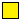 | [DHTVolumes2D](#dhtvolumes2d) | connector | Distributed heat terminal for 2D finite volume models |
|  | [BaseClasses](OpenTEMPEST_Heat_BaseClasses.md) | package | Base classes for solid and heat transfer models |
|  | [HT_DHTVolumes2D](#ht_dhtvolumes2d) | model | Adaptor from one HT port to a DHTVolumes2D port |
|  | [HTs_DHTVolumes2D](#hts_dhtvolumes2d) | model | Adaptor from several HT ports to a DHTVolumes2D port |
|  | [DHT_DHTVolumes2D](#dht_dhtvolumes2d) | model | Adaptor from a DHTVolumes port to a DHTVolumes2D port |
|  | [DHT_2DHT](#dht_2dht) | model | Adaptor splitting one distributed heat port into two |
|  | [ThermalCollector1D](#thermalcollector1d) | model | Collects m heat flows through 1D thermal ports |
|  | [ThermalCollector2D](#thermalcollector2d) | model | Collects m heat flows through 2D thermal ports |
|  | [ForcedConvection](#forcedconvection) | model | Heat transfer correlation for forced convection |
|  | [RadiativeHeatTransferGenericEnumerate](#radiativeheattransfergenericenumerate) | model | 0D radiative heat transfer between two surfaces (A2 >= A1, A1 convex or flat) |
|  | [RadiativeHeatFlowSplitter](#radiativeheatflowsplitter) | model | Splits a radiative heat flow using only one reference temperature |
|  | [RadHTFV](#radhtfv) | model | Distributed radiative heat transfer between two 1D finite volume surfaces |
|  | [ThermalR_HeatC_FV](#thermalr_heatc_fv) | model | Thermal resistance between a finite volume object and a lumped heat capacity |
|  | [conductiveHT](#conductiveht) | model | Conductive heat transfer through a layer with constant conductivity |
|  | [conductiveHTVarLambda](#conductivehtvarlambda) | model | Conductive heat transfer through an insulation layer with temperature dependent conductivity |
|  | [ConductiveFV](#conductivefv) | model | Conductive thermal resistance without mass |
|  | [InsulationVarArea](#insulationvararea) | model | Insulation layer with variable area (obsolete, use Solid0DvarArea) |
|  | [HeatTransferNodeUA](#heattransfernodeua) | model | Heat transfer between two distributed heat ports with UA scaled by mass flow |
|  | [Solid0D](#solid0d) | model | Lumped (0D) solid with temperature dependent material properties |
|  | [Solid1D](#solid1d) | model | 1D finite volume solid with temperature dependent material properties |
|  | [Solid2D](#solid2d) | model | 2D finite volume solid with temperature dependent material properties |
| 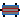 | [Solid3D](#solid3d) | model | 3D finite volume solid with temperature dependent material properties |
|  | [Solid0DvarArea](#solid0dvararea) | model | Lumped solid with area varying along x (truncated pyramid) |
|  | [Solid1DvarArea](#solid1dvararea) | model | 1D solid with area varying along x (truncated pyramid) |
|  | [RadHT2DFV](#radht2dfv) | model | Distributed radiative heat transfer between two 2D finite volume surfaces |
|  | [ThermalConductor1D](#thermalconductor1d) | model | Lumped thermal element transporting heat without storing it with 1D thermal ports |
| 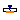 | [PrescribedTemperature1D](#prescribedtemperature1d) | model | Prescribed temperature boundary condition for a distributed heat port |
|  | [TempSource2DUniform](#tempsource2duniform) | model | Uniformly distributed temperature source for 2D finite volume models |
|  | [TempSource2DNonUniform](#tempsource2dnonuniform) | model | Non-uniformly distributed temperature source for 2D finite volume models |
|  | [HeatSource2DNonUniformFV](#heatsource2dnonuniformfv) | model | Non-uniformly distributed heat flow source for 2D finite volume models |

---

## HTs_HT


`model OpenTEMPEST.Heat.HTs_HT`

*Adaptor from several HT ports to one HT port*

**Parameters**

| Name | Description | Unit |
|---|---|---|
| `N` | Number of HTs (= number of nodes on DHT side) |  |

**Connectors**

| Name | Description | Unit |
|---|---|---|
| `HT_ports[N]` | `ThermoPower.Thermal.HT` |  |
| `HT_port` | `ThermoPower.Thermal.HT` |  |

[Back to top](#opentempestheat)

---

## HTs_DHT


`model OpenTEMPEST.Heat.HTs_DHT`

*Adaptor from several HT ports to one DHTVolumes port*

**Parameters**

| Name | Description | Unit |
|---|---|---|
| `N` | Number of HTs (= number of nodes on DHT side) |  |

**Connectors**

| Name | Description | Unit |
|---|---|---|
| `HT_ports[N]` | `ThermoPower.Thermal.HT` |  |
| `DHT_port` | `ThermoPower.Thermal.DHTVolumes` |  |

[Back to top](#opentempestheat)

---

## DHTVolumes2D

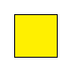

`connector OpenTEMPEST.Heat.DHTVolumes2D`

*Distributed heat terminal for 2D finite volume models*

**Parameters**

| Name | Description | Unit |
|---|---|---|
| `i` | number of volumes in direction 1 |  |
| `j` | number of volumes in direction 2 |  |

**Contents**

| Name | Description | Unit |
|---|---|---|
| `i` | number of volumes in direction 1 |  |
| `j` | number of volumes in direction 2 |  |
| `T[i, j]` | Temperature at the volumes | `K` |
| `Q[i, j]` | Heat flow at the volumes | `W` |

[Back to top](#opentempestheat)

---

## HT_DHTVolumes2D

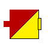

`model OpenTEMPEST.Heat.HT_DHTVolumes2D`

*Adaptor from one HT port to a DHTVolumes2D port*

**Parameters**

| Name | Description | Unit |
|---|---|---|
| `i` | number of volumes in direction 1 |  |
| `j` | number of volumes in direction 2 |  |

**Connectors**

| Name | Description | Unit |
|---|---|---|
| `HT_port` | `ThermoPower.Thermal.HT` |  |
| `DHT_port` | `OpenTEMPEST.Heat.DHTVolumes2D` |  |

[Back to top](#opentempestheat)

---

## HTs_DHTVolumes2D

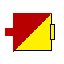

`model OpenTEMPEST.Heat.HTs_DHTVolumes2D`

*Adaptor from several HT ports to a DHTVolumes2D port*

**Parameters**

| Name | Description | Unit |
|---|---|---|
| `i` | number of volumes in direction 1 |  |
| `j` | number of volumes in direction 2 |  |

**Connectors**

| Name | Description | Unit |
|---|---|---|
| **HT_ports[i, j]** | | |
| `DHT_port` | `OpenTEMPEST.Heat.DHTVolumes2D` |  |

[Back to top](#opentempestheat)

---

## DHT_DHTVolumes2D

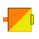

`model OpenTEMPEST.Heat.DHT_DHTVolumes2D`

*Adaptor from a DHTVolumes port to a DHTVolumes2D port*

**Parameters**

| Name | Description | Unit |
|---|---|---|
| `i` | number of DHT volumes (direction 1) |  |
| `j` | number elements in DHT Volume (direction 2) |  |

**Connectors**

| Name | Description | Unit |
|---|---|---|
| `DHT_port[i]` | `ThermoPower.Thermal.DHTVolumes` |  |
| `DHT2D_port` | `OpenTEMPEST.Heat.DHTVolumes2D` |  |

[Back to top](#opentempestheat)

---

## DHT_2DHT


`model OpenTEMPEST.Heat.DHT_2DHT`

*Adaptor splitting one distributed heat port into two*

**Parameters**

| Name | Description | Unit |
|---|---|---|
| `n` | number of volumens at single port |  |
| `r` | split ratio of the volumes |  |

**Connectors**

| Name | Description | Unit |
|---|---|---|
| `DHTSingle` | `ThermoPower.Thermal.DHTVolumes` |  |
| `DHT1` | `ThermoPower.Thermal.DHTVolumes` |  |
| `DHT2` | `ThermoPower.Thermal.DHTVolumes` |  |

[Back to top](#opentempestheat)

---

## ThermalCollector1D


`model OpenTEMPEST.Heat.ThermalCollector1D`

*Collects m heat flows through 1D thermal ports*

This is a model to collect the heat flows from *m* heatports to one single heatport.

**Parameters**

| Name | Description | Unit |
|---|---|---|
| `m` | Number of collected heat flows |  |
| `N` | Number of control volumes |  |

**Connectors**

| Name | Description | Unit |
|---|---|---|
| `dHT0[m]` | `ThermoPower.Thermal.DHTVolumes` |  |
| `dHT1` | `ThermoPower.Thermal.DHTVolumes` |  |

[Back to top](#opentempestheat)

---

## ThermalCollector2D


`model OpenTEMPEST.Heat.ThermalCollector2D`

*Collects m heat flows through 2D thermal ports*

This is a model to collect the heat flows from *m* heatports to one single heatport.

**Parameters**

| Name | Description | Unit |
|---|---|---|
| `m` | Number of collected heat flows |  |
| `n` | Number of collected heat flows |  |

**Connectors**

| Name | Description | Unit |
|---|---|---|
| **port_a[m, n]** | | |
| `port_b` | `Modelica.Thermal.HeatTransfer.Interfaces.HeatPort_b` |  |

[Back to top](#opentempestheat)

---

## ForcedConvection


`model OpenTEMPEST.Heat.ForcedConvection`

*Heat transfer correlation for forced convection*

Extends from ThermoPower.Thermal.BaseClasses.DistributedHeatTransferFV (Base class for distributed heat transfer models - finite volumes).

**Parameters**

| Name | Description | Unit |
|---|---|---|
| `useAverageTemperature` | = true to use average temperature for heat transfer |  |
| `kc` | Correction factor for heat transfer |  |
| `pipe` | = true if flow through a pipe, false if between two parallel plates |  |
| **Set by Flow1D model** | | |
| `Medium` | *replaceable package*: Medium model |  |
| `Nf` | Number of nodes on the fluid side |  |
| `Nw` | Number of volumes on the wall side |  |
| `Nt` | Number of tubes in parallel |  |
| `L` | Tube length | `m` |
| `A` | Cross-sectional area (single tube) | `m2` |
| `omega` | Wet perimeter of heat transfer surface (single tube) | `m` |
| `Dhyd` | Hydraulic Diameter (single tube) | `m` |
| `wnom` | Nominal mass flow rate (single tube) | `kg/s` |

**Connectors**

| Name | Description | Unit |
|---|---|---|
| `wall` |  |  |

[Back to top](#opentempestheat)

---

## RadiativeHeatTransferGenericEnumerate

`model OpenTEMPEST.Heat.RadiativeHeatTransferGenericEnumerate`

*0D radiative heat transfer between two surfaces (A2 >= A1, A1 convex or flat)*

**Parameters**

| Name | Description | Unit |
|---|---|---|
| `epsilon1` | emissivity of surface 1 |  |
| `epsilon2` | emissivity of surface 2 |  |
| `A1` | Area of surface 1, used for special case | `m2` |
| `A2` | Area of surface 2 | `m2` |
| `specialCase` | Radiation Special Case |  |

**Connectors**

| Name | Description | Unit |
|---|---|---|
| `side1` | `ThermoPower.Thermal.HT` |  |
| `side2` | `ThermoPower.Thermal.HT` |  |

[Back to top](#opentempestheat)

---

## RadiativeHeatFlowSplitter

`model OpenTEMPEST.Heat.RadiativeHeatFlowSplitter`

*Splits a radiative heat flow using only one reference temperature*

**Parameters**

| Name | Description | Unit |
|---|---|---|
| `nCombinedPorts` | number of heat ports that are combined, the firsts' temperature is used for radiation |  |
| `epsilon1` | emissivity of surface 1 |  |
| `epsilonC` | emissivity of the combined surface (side2) |  |
| `A1` | Area of surface 1 | `m2` |
| `AC[nCombinedPorts]` | Area of combined surfaces | `m2` |
| `specialCase` | Radiation Special Case |  |

**Connectors**

| Name | Description | Unit |
|---|---|---|
| `side1` | `ThermoPower.Thermal.HT` |  |
| `side2[nCombinedPorts]` | `ThermoPower.Thermal.HT` |  |

[Back to top](#opentempestheat)

---

## RadHTFV


`model OpenTEMPEST.Heat.RadHTFV`

*Distributed radiative heat transfer between two 1D finite volume surfaces*

**Parameters**

| Name | Description | Unit |
|---|---|---|
| `N` | Number of discretisation Units |  |
| `specialCase` |  |  |
| `epsilon1` |  |  |
| `epsilon2` |  |  |
| `A1` |  |  |
| `A2` |  |  |

**Connectors**

| Name | Description | Unit |
|---|---|---|
| `side1` | `ThermoPower.Thermal.DHTVolumes` |  |
| `side2` | `ThermoPower.Thermal.DHTVolumes` |  |

[Back to top](#opentempestheat)

---

## ThermalR_HeatC_FV

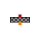

`model OpenTEMPEST.Heat.ThermalR_HeatC_FV`

*Thermal resistance between a finite volume object and a lumped heat capacity*

**Parameters**

| Name | Description | Unit |
|---|---|---|
| `N` | Number of nodes of DHT |  |
| `R` | Constant thermal resistance | `K/W` |
| `C` | Heat capacity of element (= cp\*m) | `J/K` |
| `Tstart` | Start value of the temperature of element | `K` |

**Connectors**

| Name | Description | Unit |
|---|---|---|
| `dHT` | `ThermoPower.Thermal.DHTVolumes` |  |
| `hT` | `ThermoPower.Thermal.HT` |  |

[Back to top](#opentempestheat)

---

## conductiveHT

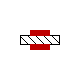

`model OpenTEMPEST.Heat.conductiveHT`

*Conductive heat transfer through a layer with constant conductivity*

Extends from ThermoPower.Icons.HeatFlow.

**Parameters**

| Name | Description | Unit |
|---|---|---|
| `lambda` | thermalConductivity | `W/(m.K)` |
| `L` | length | `m` |
| `A` | cross sectional area | `m2` |

**Connectors**

| Name | Description | Unit |
|---|---|---|
| `side1` | `ThermoPower.Thermal.HT` |  |
| `side2` | `ThermoPower.Thermal.HT` |  |

[Back to top](#opentempestheat)

---

## conductiveHTVarLambda

`model OpenTEMPEST.Heat.conductiveHTVarLambda`

*Conductive heat transfer through an insulation layer with temperature dependent conductivity*

Extends from ThermoPower.Icons.HeatFlow.

**Parameters**

| Name | Description | Unit |
|---|---|---|
| `L` | length | `m` |
| `A` | cross sectional area | `m2` |
| `matOpt` | Options for insulation materials |  |
| `matLin` | c and lambda = linear(f(T)) |  |
| `matConst` | c and lambda = f(TStart) = const. |  |
| `Fac` | Correction factor for thermal conductivity |  |

**Connectors**

| Name | Description | Unit |
|---|---|---|
| `side1` | `ThermoPower.Thermal.HT` |  |
| `side2` | `ThermoPower.Thermal.HT` |  |

[Back to top](#opentempestheat)

---

## ConductiveFV


`model OpenTEMPEST.Heat.ConductiveFV`

*Conductive thermal resistance without mass*

**Parameters**

| Name | Description | Unit |
|---|---|---|
| `N` | Number of nodes |  |
| `lambda` | thermalConductivity | `W/(m.K)` |
| `L` | length between heat ports | `m` |
| `A` | cross sectional area | `m2` |

**Connectors**

| Name | Description | Unit |
|---|---|---|
| `side1` | Internal surface |  |
| `side2` | External surface |  |

[Back to top](#opentempestheat)

---

## InsulationVarArea


`model OpenTEMPEST.Heat.InsulationVarArea`

*Insulation layer with variable area (obsolete, use Solid0DvarArea)*

Extends from Modelica.Icons.ObsoleteModel (Icon for classes that are obsolete and will be removed in later versions).

**Parameters**

| Name | Description | Unit |
|---|---|---|
| `lambda` | thermalConductivity | `W/(m.K)` |
| `c` | SpecificHeatCapacity | `J/(kg.K)` |
| `rho` | Density | `kg/m3` |
| `area1` | area1 | `m2` |
| `area2` | area2 | `m2` |
| `depth` | depth | `m` |
| `TStart` | Start temperature | `K` |

**Connectors**

| Name | Description | Unit |
|---|---|---|
| `ht1` | `ThermoPower.Thermal.HT` |  |
| `ht2` | `ThermoPower.Thermal.HT` |  |
| `htC` | `ThermoPower.Thermal.HT` |  |

[Back to top](#opentempestheat)

---

## HeatTransferNodeUA


`model OpenTEMPEST.Heat.HeatTransferNodeUA`

*Heat transfer between two distributed heat ports with UA scaled by mass flow*

Extends from [OpenTEMPEST.Heat.BaseClasses.HeatTransferNodeBase](OpenTEMPEST_Heat_BaseClasses.md#heattransfernodebase).

**Parameters**

| Name | Description | Unit |
|---|---|---|
| `N` |  |  |
| `UAnom` |  |  |
| `mfNom` |  | `kg/s` |

**Connectors**

| Name | Description | Unit |
|---|---|---|
| `coldWall` | `ThermoPower.Thermal.DHTVolumes` |  |
| `hotWall` | `ThermoPower.Thermal.DHTVolumes` |  |
| `mf` | `Modelica.Blocks.Interfaces.RealInput` |  |

[Back to top](#opentempestheat)

---

## Solid0D

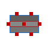

`model OpenTEMPEST.Heat.Solid0D`

*Lumped (0D) solid with temperature dependent material properties*

Extends from [OpenTEMPEST.Heat.BaseClasses.Solid0DBase](OpenTEMPEST_Heat_BaseClasses.md#solid0dbase).

**Parameters**

| Name | Description | Unit |
|---|---|---|
| `SolidMat` | *replaceable package* |  |
| **Initialisation** | | |
| `Tstartbar` | Uniform initial temperature of the solid | `K` |
| **Dimensions** | | |
| `lX` | Total length of solid | `m` |
| `lY` | Total width of solid | `m` |
| `lZ` | Total thickness of solid | `m` |
| **Dimensions Extra** | | |
| `dV` | Volume of the solid |  |
| `Ax` | Cross sectional area in x-plane | `m2` |
| `Ay` | Cross sectional area in y-plane | `m2` |
| `Az` | Cross sectional area in z-plane | `m2` |
| **Custom Material Only** | | |
| `kCustom_trans` |  | `W/(m.K)` |
| `kCustom_long` |  | `W/(m.K)` |
| `rhoCustom` |  | `kg/m3` |
| `cpCustom` |  | `J/(kg.K)` |

**Connectors**

| Name | Description | Unit |
|---|---|---|
| `hT_xN` | `ThermoPower.Thermal.HT` |  |
| `hT_zN` | `ThermoPower.Thermal.HT` |  |
| `hT_z0` | `ThermoPower.Thermal.HT` |  |
| `hT_y0` | `ThermoPower.Thermal.HT` |  |
| `hT_yN` | `ThermoPower.Thermal.HT` |  |
| `hT_int` | `ThermoPower.Thermal.HT` |  |
| `hT_x0` | `ThermoPower.Thermal.HT` |  |

[Back to top](#opentempestheat)

---

## Solid1D


`model OpenTEMPEST.Heat.Solid1D`

*1D finite volume solid with temperature dependent material properties*

Extends from [OpenTEMPEST.Heat.BaseClasses.Solid1DBase](OpenTEMPEST_Heat_BaseClasses.md#solid1dbase).

**Parameters**

| Name | Description | Unit |
|---|---|---|
| `SolidMat` | *replaceable package* |  |
| `N` | Number of CVs in the solid |  |
| **Initialisation** | | |
| `Tstartbar` | Uniform initial temperature of the solid | `K` |
| **Dimensions** | | |
| `lX` | Total length of solid | `m` |
| `lY` | Total width of solid | `m` |
| `lZ` | Total thickness of solid | `m` |
| **Dimensions Extra** | | |
| `dx` | x-Length of a CV | `m` |
| `dV` | Volume of a CV | `m3` |
| `Ax` | Cross sectional area in x plane | `m2` |
| `Ay` | Cross sectional area in y-plane | `m2` |
| `Az` | Cross sectional area in z-plane | `m2` |
| **Custom Material Only** | | |
| `kCustom_trans` |  | `W/(m.K)` |
| `kCustom_long` |  | `W/(m.K)` |
| `rhoCustom` |  | `kg/m3` |
| `cpCustom` |  | `J/(kg.K)` |

**Connectors**

| Name | Description | Unit |
|---|---|---|
| `hT_x0` | `ThermoPower.Thermal.HT` |  |
| `hT_xN` | `ThermoPower.Thermal.HT` |  |
| `dhT_z1` | `ThermoPower.Thermal.DHTVolumes` |  |
| `dhT_z0` | `ThermoPower.Thermal.DHTVolumes` |  |
| `dhT_y0` | `ThermoPower.Thermal.DHTVolumes` |  |
| `dhT_y1` | `ThermoPower.Thermal.DHTVolumes` |  |
| `dhT_int` | `ThermoPower.Thermal.DHTVolumes` |  |

[Back to top](#opentempestheat)

---

## Solid2D

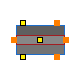

`model OpenTEMPEST.Heat.Solid2D`

*2D finite volume solid with temperature dependent material properties*

Extends from [OpenTEMPEST.Heat.BaseClasses.Solid2DBase](OpenTEMPEST_Heat_BaseClasses.md#solid2dbase).

**Parameters**

| Name | Description | Unit |
|---|---|---|
| `SolidMat` | *replaceable package* |  |
| `nX` | Number of CVs in the solid in x-direction |  |
| `nY` | Number of CVs in the solid in y-direction |  |
| **Initialisation** | | |
| `Tstartbar` | Uniform initial temperature of the solid | `K` |
| **Dimensions** | | |
| `lX` | Total length of solid in x-direction | `m` |
| `lY` | Total length of solid in y-direction | `m` |
| `lZ` | Total thickness of solid in z-direction | `m` |
| **Dimensions Extra** | | |
| `dx` | x-Length of a CV | `m` |
| `dy` | y-Length of a CV | `m` |
| `dV` | Volume of a CV | `m3` |
| `Ax` | Cross sectional area in x-plane | `m2` |
| `Ay` | Cross sectional area in y-plane | `m2` |
| `Az` | Cross sectional area in z-plane | `m2` |
| **Custom Material Only** | | |
| `kCustom_trans` | Custom thermal conductivity across layers (z-direction) | `W/(m.K)` |
| `kCustom_long` | Custom thermal conductivity in-plane (x/y); defaults to kCustom_trans | `W/(m.K)` |
| `rhoCustom` | Custom density | `kg/m3` |
| `cpCustom` | Custom specific heat capacity | `J/(kg.K)` |

**Connectors**

| Name | Description | Unit |
|---|---|---|
| `dhT_x0` | `ThermoPower.Thermal.DHTVolumes` |  |
| `dhT_xN` | `ThermoPower.Thermal.DHTVolumes` |  |
| `dhT2_z1` | `OpenTEMPEST.Heat.DHTVolumes2D` |  |
| `dhT2_z0` | `OpenTEMPEST.Heat.DHTVolumes2D` |  |
| `dhT_y0` | `ThermoPower.Thermal.DHTVolumes` |  |
| `dhT_yN` | `ThermoPower.Thermal.DHTVolumes` |  |
| `dhT2_int` | `OpenTEMPEST.Heat.DHTVolumes2D` |  |

[Back to top](#opentempestheat)

---

## Solid3D

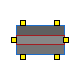

`model OpenTEMPEST.Heat.Solid3D`

*3D finite volume solid with temperature dependent material properties*

Extends from [OpenTEMPEST.Heat.BaseClasses.Solid3DBase](OpenTEMPEST_Heat_BaseClasses.md#solid3dbase).

**Parameters**

| Name | Description | Unit |
|---|---|---|
| `SolidMat` | *replaceable package* |  |
| `nX` | Number of CVs in the solid in x-direction |  |
| `nY` | Number of CVs in the solid in y-direction |  |
| `nZ` | Number of CVs in the solid in z-direction |  |
| **Initialisation** | | |
| `Tstartbar` | Uniform initial temperature of the solid | `K` |
| **Dimensions** | | |
| `lX` | Total length of solid in x-direction | `m` |
| `lY` | Total width of solid in y-direction | `m` |
| `lZ` | Total thickness of solid in z-direction | `m` |
| **Dimensions Extra** | | |
| `dx` | x-length of a CV | `m` |
| `dy` | y-length of a CV | `m` |
| `dz` | z-length of a CV | `m` |
| `dV` | Volume of a CV | `m3` |
| `Ax` | Cross sectional area in x-plane | `m2` |
| `Ay` | Cross sectional area in y-plane | `m2` |
| `Az` | Cross sectional area in z-plane | `m2` |
| **Custom Material Only** | | |
| `kCustom_trans` | Custom thermal conductivity across layers (z-direction) | `W/(m.K)` |
| `kCustom_long` | Custom thermal conductivity in-plane (x/y); defaults to kCustom_trans | `W/(m.K)` |
| `rhoCustom` | Custom density | `kg/m3` |
| `cpCustom` | Custom specific heat capacity | `J/(kg.K)` |

**Connectors**

| Name | Description | Unit |
|---|---|---|
| `dhT2_x0` | `OpenTEMPEST.Heat.DHTVolumes2D` |  |
| `dhT2_xN` | `OpenTEMPEST.Heat.DHTVolumes2D` |  |
| `dhT2_zN` | `OpenTEMPEST.Heat.DHTVolumes2D` |  |
| `dhT2_z0` | `OpenTEMPEST.Heat.DHTVolumes2D` |  |
| `dhT2_y0` | `OpenTEMPEST.Heat.DHTVolumes2D` |  |
| `dhT2_yN` | `OpenTEMPEST.Heat.DHTVolumes2D` |  |

[Back to top](#opentempestheat)

---

## Solid0DvarArea

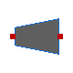

`model OpenTEMPEST.Heat.Solid0DvarArea`

*Lumped solid with area varying along x (truncated pyramid)*

truncated pyramid volume with heat transfer along x-direction. Pyramid base area is y0*z0.

**Parameters**

| Name | Description | Unit |
|---|---|---|
| `SolidMat` | *replaceable package* |  |
| **Initialisation** | | |
| `TstartIn` |  | `K` |
| `TstartOut` |  | `K` |
| `Tstart` |  | `K` |
| **Dimensions** | | |
| `lX` | Total length of solid | `m` |
| `A0` | CS area at x/L=0 | `m2` |
| `A1` | CS area at x/L=1 | `m2` |
| **Custom Material Only** | | |
| `kCustom` |  | `W/(m.K)` |
| `rhoCustom` |  | `kg/m3` |
| `cpCustom` |  | `J/(kg.K)` |

**Connectors**

| Name | Description | Unit |
|---|---|---|
| `hT_x0` | `ThermoPower.Thermal.HT` |  |
| `hT_x1` | `ThermoPower.Thermal.HT` |  |

[Back to top](#opentempestheat)

---

## Solid1DvarArea

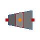

`model OpenTEMPEST.Heat.Solid1DvarArea`

*1D solid with area varying along x (truncated pyramid)*

truncated pyramid volume with heat transfer along x-direction. Pyramid base area is y0*z0.

**Parameters**

| Name | Description | Unit |
|---|---|---|
| `SolidMat` | *replaceable package* |  |
| `N` | Number of CVs in the solid |  |
| **Initialisation** | | |
| `TstartIn` |  | `K` |
| `TstartOut` |  | `K` |
| `Tstart[N]` |  | `K` |
| **Dimensions** | | |
| `lX` | Total length of solid | `m` |
| `A0` | CS area at x/L=0 | `m2` |
| `A1` | CS area at x/L=1 | `m2` |
| **Custom Material Only** | | |
| `kCustom_trans` |  | `W/(m.K)` |
| `kCustom_long` |  | `W/(m.K)` |
| `rhoCustom` |  | `kg/m3` |
| `cpCustom` |  | `J/(kg.K)` |

**Connectors**

| Name | Description | Unit |
|---|---|---|
| `hT_x0` | `ThermoPower.Thermal.HT` |  |
| `hT_xN` | `ThermoPower.Thermal.HT` |  |
| `dhT_int` | `ThermoPower.Thermal.DHTVolumes` |  |

[Back to top](#opentempestheat)

---

## RadHT2DFV

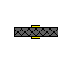

`model OpenTEMPEST.Heat.RadHT2DFV`

*Distributed radiative heat transfer between two 2D finite volume surfaces*

**Parameters**

| Name | Description | Unit |
|---|---|---|
| `nX` | Number of volumes in x-direction |  |
| `nY` | Number of volumes in y-direction |  |
| `specialCase` |  |  |
| `epsilon1` |  |  |
| `epsilon2` |  |  |
| `A1` |  |  |
| `A2` |  |  |

**Connectors**

| Name | Description | Unit |
|---|---|---|
| `side1` | `OpenTEMPEST.Heat.DHTVolumes2D` |  |
| `side2` | `OpenTEMPEST.Heat.DHTVolumes2D` |  |

[Back to top](#opentempestheat)

---

## ThermalConductor1D

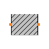

`model OpenTEMPEST.Heat.ThermalConductor1D`

*Lumped thermal element transporting heat without storing it with 1D thermal ports*

This is a model for transport of heat without storing it; see also: `ThermalResistor`. It may be used for complicated geometries where the thermal conductance G (= inverse of thermal resistance) is determined by measurements and is assumed to be constant over the range of operations. If the component consists mainly of one type of material and a regular geometry, it may be calculated, e.g., with one of the following equations:

-

Conductance for a **box** geometry under the assumption that heat flows along the box length:

```

    G = k*A/L
    k: Thermal conductivity (material constant)
    A: Area of box
    L: Length of box
    
```

  
-

Conductance for a **cylindrical** geometry under the assumption that heat flows from the inside to the outside radius of the cylinder:

```

    G = 2*pi*k*L/log(r_out/r_in)
    pi   : Modelica.Constants.pi
    k    : Thermal conductivity (material constant)
    L    : Length of cylinder
    log  : Modelica.Math.log;
    r_out: Outer radius of cylinder
    r_in : Inner radius of cylinder
    
```

  

```

    Typical values for k at 20 degC in W/(m.K):
      aluminium   220
      concrete      1
      copper      384
      iron         74
      silver      407
      steel        45 .. 15 (V2A)
      wood         0.1 ... 0.2

```

Extends from [BaseClasses.Element1D](OpenTEMPEST_Heat_BaseClasses.md#element1d) (Partial heat transfer element with two 1D thermal ports that does not store energy).

**Parameters**

| Name | Description | Unit |
|---|---|---|
| `N` | Number of control volumes |  |
| `G` | Constant thermal conductance of material | `W/K` |

**Connectors**

| Name | Description | Unit |
|---|---|---|
| `dHT0` |  |  |
| `dHT1` |  |  |

[Back to top](#opentempestheat)

---

## PrescribedTemperature1D


`model OpenTEMPEST.Heat.PrescribedTemperature1D`

*Prescribed temperature boundary condition for a distributed heat port*

This model represents a variable temperature boundary condition. The temperature in [K] is given as input signal **T** to the model. The effect is that an instance of this model acts as an infinite reservoir able to absorb or generate as much energy as required to keep the temperature at the specified value.

Extends from ThermoPower.Icons.HeatFlow.

**Parameters**

| Name | Description | Unit |
|---|---|---|
| `N` | Number of control volumes |  |

**Connectors**

| Name | Description | Unit |
|---|---|---|
| `port` | `ThermoPower.Thermal.DHTVolumes` |  |
| `T[N]` | K | `K` |

[Back to top](#opentempestheat)

---

## TempSource2DUniform

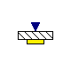

`model OpenTEMPEST.Heat.TempSource2DUniform`

*Uniformly distributed temperature source for 2D finite volume models*

Extends from [OpenTEMPEST.Heat.BaseClasses.TempSource2DBase](OpenTEMPEST_Heat_BaseClasses.md#tempsource2dbase) (Base Model Distributed Temperature Source for 2D Finite Volume models).

**Parameters**

| Name | Description | Unit |
|---|---|---|
| `nX` | Number of volumes x-direction |  |
| `nY` | Number of volumes y-direction |  |

**Connectors**

| Name | Description | Unit |
|---|---|---|
| `wall` | `OpenTEMPEST.Heat.DHTVolumes2D` |  |
| `temperature` | Temperature \[K\] | `K` |

[Back to top](#opentempestheat)

---

## TempSource2DNonUniform

`model OpenTEMPEST.Heat.TempSource2DNonUniform`

*Non-uniformly distributed temperature source for 2D finite volume models*

Extends from [OpenTEMPEST.Heat.BaseClasses.TempSource2DBase](OpenTEMPEST_Heat_BaseClasses.md#tempsource2dbase) (Base Model Distributed Temperature Source for 2D Finite Volume models).

**Parameters**

| Name | Description | Unit |
|---|---|---|
| `nX` | Number of volumes x-direction |  |
| `nY` | Number of volumes y-direction |  |

**Connectors**

| Name | Description | Unit |
|---|---|---|
| `wall` | `OpenTEMPEST.Heat.DHTVolumes2D` |  |

[Back to top](#opentempestheat)

---

## HeatSource2DNonUniformFV

`model OpenTEMPEST.Heat.HeatSource2DNonUniformFV`

*Non-uniformly distributed heat flow source for 2D finite volume models*

Extends from ThermoPower.Icons.HeatFlow.

**Parameters**

| Name | Description | Unit |
|---|---|---|
| `nX` | Number of volumes x-direction |  |
| `nY` | Number of volumes y-direction |  |

**Connectors**

| Name | Description | Unit |
|---|---|---|
| `wall` | `OpenTEMPEST.Heat.DHTVolumes2D` |  |

[Back to top](#opentempestheat)
