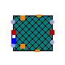

<!-- Generated by docs/tools/build_reference.py. Do not edit: change the Modelica source and re-run the script. -->

[Library reference](README.md) › [OpenTEMPEST](OpenTEMPEST.md) › [SOC](OpenTEMPEST_SOC.md) › [Cell](OpenTEMPEST_SOC_Cell.md) › **Cell1D**

# OpenTEMPEST.SOC.Cell.Cell1D

*1D co-flow cell models*

| | Class | Kind | Description |
|---|---|---|---|
|  | [Components](OpenTEMPEST_SOC_Cell_Cell1D_Components.md) | package | Components of the 1D cell: channels and PEN |
|  | [Cell](#cell) | model | 1D co-flow cell repeating unit with PEN, fuel and air channels and interconnects |
|  | [SimplifiedCellBlock](#simplifiedcellblock) | model | Simplified 1D block of cells represented by one thermal solid |

---

## Cell

`model OpenTEMPEST.SOC.Cell.Cell1D.Cell`

*1D co-flow cell repeating unit with PEN, fuel and air channels and interconnects*

The model represents a one-dimensional discretized into N control volumes along the channel direction.

The cell consists of a discretized PEN with electrochemistry, axial fuel and air channels, and metallic interconnects. Heat transfer between PEN, channels, and interconnects is modeled via convective and radiative elements. Gas manifolds supply the reactants, while Darcy-based pressure drop and electrochemical reactions are computed along the channels. Geometrical dimensions, material properties, discretization, and transport parameters are fully parameterized.

**Parameters**

| Name | Description | Unit |
|---|---|---|
| `N` | number of CVs in each layer |  |
| `lX` | Cell length in flow direction | `m` |
| `lY` | Cell width | `m` |
| `fluxInterp` | *replaceable function* |  |
| `Electrochem` | *replaceable model* |  |
| **Fuel Channel** | | |
| `FCMedium` | *replaceable package* |  |
| `lXfc` | Length of the fuel channel | `m` |
| `lYfc` | Width of the fuel channel | `m` |
| `lZfc` | Height of the fuel channel | `m` |
| `porFC` | Porosity of the fuel channel (open fraction of the width) |  |
| `Nu_PENfc` | Nusselt number fuel channel on PEN side |  |
| `Nu_ICfc` | Nusselt Number fuel channel on IC side |  |
| `kFoam` | Thermal conductivity of the nickel foam in the fuel channel | `W/(m.K)` |
| `cpFoam` | Specific heat capacity of the nickel foam | `J/(kg.K)` |
| `rhoFoam` | Density of the nickel foam | `kg/m3` |
| `HyR_Fuel` | Hydraulic resistance of fuel channel of each single cell in stack | `Pa/(kg/s)` |
| **Air Channel** | | |
| `ACMedium` | *replaceable package* |  |
| `lXac` | Length of the air channel | `m` |
| `lYac` | Width of the air channel | `m` |
| `lZac` | Height of the air channel | `m` |
| `porAC` | Porosity of the air channel (open fraction of the width) |  |
| `pDropAC` | Pressure drop in the air channel as a fraction of the inlet pressure |  |
| `Nu_PENac` | Nusselt number air channel on PEN side |  |
| `Nu_ICac` | Nusselt Number air channel on IC side |  |
| `HyR_Air` | Hydraulic resistance of air channel of each single cell in stack | `Pa/(kg/s)` |
| **Initialization** | | |
| `TStart` | Uniform start temperature | `K` |
| `TStart_pen` | Start temperature of the PEN | `K` |
| `TStart_FCin` | Start temperature at the fuel channel inlet | `K` |
| `TStart_FCout` | Start temperature at the fuel channel outlet | `K` |
| `TStart_ACin` | Start temperature at the air channel inlet | `K` |
| `TStart_ACout` | Start temperature at the air channel outlet | `K` |
| `TStart_IC` | Start temperature of the interconnects | `K` |
| `pStartAC` | Start pressure in the air channel | `Pa` |
| `pStartInFC` | Start pressure at the fuel channel inlet | `Pa` |
| `pStartOutFC` | Start pressure at the fuel channel outlet | `Pa` |
| `Jstart` | Start value of the current density | `A/m2` |
| `xStartAC[ACMedium.nXi]` | Start mass fractions in the air channel |  |
| `xStartFC[FCMedium.nX]` | Start mass fractions in the fuel channel |  |
| `dpNomFC` | nominal pressure loss for initialization | `Pa` |
| **PEN** | | |
| `lXpen` | Length of the PEN | `m` |
| `lYpen` | Width of the PEN | `m` |
| `lZpen` | Thickness of the PEN | `m` |
| `kPen` | Thermal conductivity of the PEN | `W/(m.K)` |
| `rhoPen` | Density of the PEN | `kg/m3` |
| `cpPen` | Specific heat capacity of the PEN | `J/(kg.K)` |
| `epsilon_pen` | emissivity of Anode-Electrolyte-Cathode unit |  |
| **Interconnect** | | |
| `epsilon_ic` | emissivity of surface of IC |  |
| `lZIC` | half of IC height | `m` |
| `rhoIC` | Density of IC unit | `kg/m3` |
| `cpIC` | specific heat capcity of IC | `J/(kg.K)` |
| `LambdaIC` | thermal conductivity of IC | `W/(m.K)` |

**Connectors**

| Name | Description | Unit |
|---|---|---|
| `fuelFlangeIn` | `ThermoPower.Gas.FlangeA` |  |
| `fuelFlangeOut` | `ThermoPower.Gas.FlangeB` |  |
| `airFlangeIn` | `ThermoPower.Gas.FlangeA` |  |
| `airFlangeOut` | `ThermoPower.Gas.FlangeB` |  |
| `pin_p` | `Modelica.Electrical.Analog.Interfaces.PositivePin` |  |
| `pin_n` | `Modelica.Electrical.Analog.Interfaces.NegativePin` |  |
| `dHT_z1` | `ThermoPower.Thermal.DHTVolumes` |  |
| `dHT_z0` | `ThermoPower.Thermal.DHTVolumes` |  |
| `dHT_y0` | `ThermoPower.Thermal.DHTVolumes` |  |
| `dHT_y1` | `ThermoPower.Thermal.DHTVolumes` |  |
| `hT_x0` | `ThermoPower.Thermal.HT` |  |
| `hT_xN` | `ThermoPower.Thermal.HT` |  |

[Back to top](#opentempestsoccellcell1d)

---

## SimplifiedCellBlock

`model OpenTEMPEST.SOC.Cell.Cell1D.SimplifiedCellBlock`

*Simplified 1D block of cells represented by one thermal solid*

This model represents a simplified 1D block of cells and associated thermal volumes. It discretizes the block of cells into N control volumes along the x-direction and optionally represents multiple cells stacked in the z-direction.

**Parameters**

| Name | Description | Unit |
|---|---|---|
| `N` | number of CVs in each layer |  |
| `nCellVertMult` | number of cells this object is representing in z direction |  |
| `TStart` | Starting temperature | `K` |
| `lX` | Length of active part of cell | `m` |
| `lY` | Width of active part of cell | `m` |
| `lZ` | Thickness of IC over the active part of cell | `m` |
| `rho_custom` | Density of custom material | `kg/m3` |
| `cp_custom` | Specific Heat capacity of custom material | `J/(kg.K)` |
| `k_custom` | Thermal condusctivity of custom material | `W/(m.K)` |
| **Interconnect** | | |
| `k_solidCustomLong` | Thermal Conductivity of solid along x-direction | `W/(m.K)` |
| `k_solidCustomTrans` | Thermal Conductivity of solid along z-direction | `W/(m.K)` |
| `cp_solidCustom` | Specific heat capacity of solid parallel to windows | `J/(kg.K)` |
| `rho_solidCustom` | Density of solid parallel to windows | `kg/m3` |

**Connectors**

| Name | Description | Unit |
|---|---|---|
| `hTactive_x0[nCellVertMult]` | `ThermoPower.Thermal.HT` |  |
| `hTactive_x1[nCellVertMult]` | `ThermoPower.Thermal.HT` |  |
| `dHTactive_y0` | `ThermoPower.Thermal.DHTVolumes` |  |
| `dHTactive_y1` | `ThermoPower.Thermal.DHTVolumes` |  |
| `dHTactive_z0` | `ThermoPower.Thermal.DHTVolumes` |  |
| `dHTactive_z1` | `ThermoPower.Thermal.DHTVolumes` |  |
| `simpFlowInfoPortIn[N]` | `Electrochem.Interfaces.SimpFlowInfoPort` |  |
| `reactionHeatInfoPort[N]` | `Electrochem.Interfaces.ReactionHeatInfoPort` |  |
| `simpFlowInfoPortOut[N]` | `Electrochem.Interfaces.SimpFlowInfoPort` |  |

[Back to top](#opentempestsoccellcell1d)
