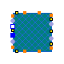
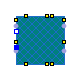
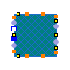
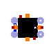

<!-- Generated by docs/tools/build_reference.py. Do not edit: change the Modelica source and re-run the script. -->

[Library reference](README.md) › [OpenTEMPEST](OpenTEMPEST.md) › [SOC](OpenTEMPEST_SOC.md) › **Stack**

# OpenTEMPEST.SOC.Stack

*Stack models*

| | Class | Kind | Description |
|---|---|---|---|
|  | [Components](OpenTEMPEST_SOC_Stack_Components.md) | package | Components for stack models |
|  | [StackCF](#stackcf) | model | Stack of 2D cross-flow cells with end plates and manifolds |
|  | [SimplifiedStackCF](#simplifiedstackcf) | model | Cross-flow stack with a few detailed cells and simplified cell blocks in between |
|  | [StackCFSimpCell](#stackcfsimpcell) | model | Stack of simplified cross-flow cells with 1D fuel and air channels |
|  | [SimplifiedCellBlockCF](#simplifiedcellblockcf) | model | Simplified cross-flow block of cells represented by one thermal solid |
|  | [Stack1D](#stack1d) | model | Stack of 1D co-flow cells with end plates and manifolds |
|  | [SimplifiedStack1D](#simplifiedstack1d) | model | 1D stack with a few detailed cells and simplified cell blocks in between |
|  | [Stack0D](#stack0d) | model | Lumped (0D) stack based on an ASR, with full internal reforming and no pressure loss |

---

## StackCF

`model OpenTEMPEST.SOC.Stack.StackCF`

*Stack of 2D cross-flow cells with end plates and manifolds*

This model represents a two-dimensional crossflow stack composed of multiple SOC cells arranged in the z-direction. Each cell includes discretized PEN, air and fuel channels, and interconnects. The stack integrates top and bottom plates and gas manifolds to distribute reactants to all cells.

**Parameters**

| Name | Description | Unit |
|---|---|---|
| `nX` | Number of control volumes in the x-direction |  |
| `nY` | Number of control volumes in the y-direction |  |
| `Ncell` | Total number of cells in the stack |  |
| **Dimensions** | | |
| `lX` | Length of solid | `m` |
| `lY` | Width of solid | `m` |
| `lXpen` | Length of pen | `m` |
| `lYpen` | Width of pen | `m` |
| `lZpen` | Thickness of pen | `m` |
| `lXac` | Length of air channel | `m` |
| `lYac` | Width of air channel | `m` |
| `lZac` | Height of air channel | `m` |
| `lXfc` | Length of fuel channel | `m` |
| `lYfc` | Width of fuel channel | `m` |
| `lZfc` | Height of fuel channel | `m` |
| `lZsolid` | Height of interconnector | `m` |
| `Bac` | Width of air channel without ribs | `m` |
| `Bfc` | Width of fuel channel without ribs | `m` |
| **Initialization** | | |
| `TStart` | Uniform start temperature | `K` |
| `pStart` | Starting pressure | `Pa` |
| `Jstart` | Starting current density in PEN | `A/m2` |
| `xStartFC[FCMedium.nXi]` | Starting mass fraction in fuel channel |  |
| `xStartAC[ACMedium.nX]` | Starting mass fraction in air channel |  |
| **PEN** | | |
| `Electrochem` | *replaceable model* |  |
| `kCustom_trans` | Thermal Conductivity across layers of PEN in W/mK | `W/(m.K)` |
| `kCustom_long` | Thermal Conductivity in plane of layers of PEN in W/mK | `W/(m.K)` |
| `rhoPEN` | Density of PEN in kg/m3 | `kg/m3` |
| `cpPEN` | Specific heat capacity of PEN in J/kgK | `J/(kg.K)` |
| `epsilonPEN` | Emissivity of Anode-Electrolyte-Cathode unit |  |
| **Fuel Channel** | | |
| `FCMedium` | *replaceable package* |  |
| `porFC` | Porosity in fuel channel |  |
| `NuFCPEN` | Nusselt number fuel channel on PEN side |  |
| `NuFCIC` | Nusselt number fuel channel on IC side |  |
| **Air Channel** | | |
| `ACMedium` | *replaceable package* |  |
| `porAC` | Porosity in air channel |  |
| `pDrop` | Pressure drop as a factor of inlet pressure (between 0 and 0.99) |  |
| `NuACPEN` | Nusselt number air channel on PEN side |  |
| `NuACIC` | Nusselt number air channel on IC side |  |
| **Interconnects** | | |
| `kIC` | Thermal conductivity of ribs in W/mK | `W/(m.K)` |
| `cpIC` | Ribs heat capacity in W/mK | `J/(kg.K)` |
| `rhoIC` | Ribs density in kg/m3 | `kg/m3` |
| `epsilonIC` | Emissivity of interconnects |  |

**Connectors**

| Name | Description | Unit |
|---|---|---|
| `pin_p` | `Modelica.Electrical.Analog.Interfaces.PositivePin` |  |
| `pin_n` | `Modelica.Electrical.Analog.Interfaces.NegativePin` |  |
| `fuelIn` | `ThermoPower.Gas.FlangeA` |  |
| `airIn` | `ThermoPower.Gas.FlangeA` |  |
| `fuelOut` | `ThermoPower.Gas.FlangeB` |  |
| `airout` | `ThermoPower.Gas.FlangeB` |  |
| `dHT2_top` | `Heat.DHTVolumes2D` |  |
| `dHT2_bottom` | `Heat.DHTVolumes2D` |  |
| `dHT2_x0` | `Heat.DHTVolumes2D` |  |
| `dHT2_xN` | `Heat.DHTVolumes2D` |  |
| `dHT2_yN` | `Heat.DHTVolumes2D` |  |
| `dHT2_y0` | `Heat.DHTVolumes2D` |  |
| `dHTtopPlate_x0` | `ThermoPower.Thermal.DHTVolumes` |  |
| `dHTtopPlate_xN` | `ThermoPower.Thermal.DHTVolumes` |  |
| `dHTbottomPlate_xN` | `ThermoPower.Thermal.DHTVolumes` |  |
| `dHTbottomPlate_x0` | `ThermoPower.Thermal.DHTVolumes` |  |
| `dHTtopPlate_yN` | `ThermoPower.Thermal.DHTVolumes` |  |
| `dHTbottomPlate_yN` | `ThermoPower.Thermal.DHTVolumes` |  |
| `dHTtopPlate_y0` | `ThermoPower.Thermal.DHTVolumes` |  |
| `dHTbottomPlate_y0` | `ThermoPower.Thermal.DHTVolumes` |  |

[Back to top](#opentempestsocstack)

---

## SimplifiedStackCF

`model OpenTEMPEST.SOC.Stack.SimplifiedStackCF`

*Cross-flow stack with a few detailed cells and simplified cell blocks in between*

This model represents a crossflow fuel cell stack with a simplified approach. Out of a total of `Ncell` cells, `NdetailedCell` are modeled in full detail, while the remaining cells are approximated using simplified heat transfer blocks. The model includes thermal, fluid, and electrical interactions and supports interpolation of flow and voltage between detailed and simplified cells.

**Parameters**

| Name | Description | Unit |
|---|---|---|
| `nX` | Number of control volumes in the x-direction |  |
| `nY` | Number of control volumes in the y-direction |  |
| `Ncell` | Total number of cells in the stack |  |
| `LUDS` | Set true if Linear upwind difference wanted (more accuracy), false for Upwind difference scheme (more speed and stability) |  |
| `NdetailedCell` | number of cells that are calculated in detail |  |
| `verticalBlockSize[:]` | Vertical size of the simplified blocks (e.g. 3 represents three cells merged in one simplfied block). Sum needs to be Ncell-NdetailedCell |  |
| `nCellVertMultHelp[nY, nX, nSimpMult]` | Helping parameter to build nCellVertMult |  |
| `nCellVertMult[nSimpMult, nX, nY]` | Vertical size of the simplified blocks information passed to all control volumes |  |
| `nSimpMult` | number of blocks of simplified cells |  |
| `nIMPs` | number of intermediate plates |  |
| `stackingHelper[Ncell]` | define which cell is detailed (0) or simplified (1) |  |
| **Dimensions** | | |
| `lX` | total length of solid | `m` |
| `lY` | Width of solid | `m` |
| `lXpen` | Length of pen | `m` |
| `lYpen` | Width of pen | `m` |
| `lZpen` | Thickness of pen | `m` |
| `lXac` | Length of air channel | `m` |
| `lYac` | Width of air channel | `m` |
| `lZac` | Height of air channel | `m` |
| `lXfc` | Length of fuel channel | `m` |
| `lYfc` | Width of fuel channel | `m` |
| `lZfc` | Height of fuel channel | `m` |
| `lZsolid` | Height of interconnector | `m` |
| `Bac` | Width of air channel without ribs | `m` |
| `Bfc` | WIdth of fuel channel without ribs | `m` |
| **Initialization** | | |
| `TStart` | Uniform start temperature | `K` |
| `pStart` | Starting pressure | `Pa` |
| `JStart` | Starting current density | `A/m2` |
| `xStartFC[FCMedium.nXi]` | Starting mass fraction in fuel channel |  |
| `xStartAC[ACMedium.nXi]` | Starting mass fraction in air channel |  |
| **PEN** | | |
| `Electrochem` | *replaceable model* |  |
| `kCustom_trans` | Thermal conductivity across layers of PEN in W/mK | `W/(m.K)` |
| `kCustom_long` | Thermal conductivity in plane of layers of PEN in W/mK | `W/(m.K)` |
| `rhoPEN` | Density of PEN in kg/m3 | `kg/m3` |
| `cpPEN` | Specific heat capacity of PEN in J/kgK | `J/(kg.K)` |
| `epsilonPEN` | Emissivity of PEN |  |
| `lambdaPEN` | Thermal conductivity of simplified PEN | `W/(m.K)` |
| `TPENRad` | IC temperature assumption for radiative heat transfer | `K` |
| **Fuel Channel** | | |
| `FCMedium` | *replaceable package* |  |
| `porFC` | Porosity in fuel channel |  |
| `NuFCPEN` | Nusselt number fuel channel on PEN side |  |
| `NuFCIC` | Nusselt number fuel channel on IC side |  |
| `lambdaFuel` | Themal conductivity of the gas in the fuel channel | `W/(m.K)` |
| **Air Channel** | | |
| `ACMedium` | *replaceable package* |  |
| `pDrop` | pressure drop as a factor of inlet pressure (between 0 and 0.99) |  |
| `NuACPEN` | Nusselt number air channel on PEN side |  |
| `NuACIC` | Nusselt number air channel on IC side |  |
| `lambdaAir` | Thermal conductivity of gas in air channel | `W/(m.K)` |
| `porAC` | Porosity in air channel |  |
| **Interconnects** | | |
| `rhoIC` | Density of IC | `kg/m3` |
| `cpIC` | Specific heat capacity of IC | `J/(kg.K)` |
| `epsilonIC` | Emissivity of interconnects |  |
| `lambdaIC` | Thermal conductivity of interconnects | `W/(m.K)` |
| `TICRad` | IC temperature assumption for radiative heat transfer | `K` |
| **Simplifications** | | |
| `RIC` | Resistance for interconnect thermal conduction | `K/W` |
| `RPEN` | Resistance for PEN thermal conduction | `K/W` |
| `RCondRibsAC` | Resistance for ribs conduction air channel side | `K/W` |
| `RConvACPEN` | Air channel PEN side convection resistance | `K/W` |
| `RConvACIC` | Air channel IC side convection resistance | `K/W` |
| `RConvAC` | Air channel total convection resistance | `K/W` |
| `RRadAC` | Resistance for radiation air channel side | `K/W` |
| `RAC` | Air channel total resistance without ribs conduction | `K/W` |
| `RCondRibsFC` | Resistance for ribs conduction fuel channel side | `K/W` |
| `RConvFCPEN` | Fuel channel PEN side convection | `K/W` |
| `RConvFCIC` | Fuel channel IC side convection | `K/W` |
| `RConvFC` | Fuel channel total convection resistance | `K/W` |
| `RRadFC` | Resistance for radiation fuel channel side | `K/W` |
| `RFC` | Fuel channel total resistance without ribs conduction | `K/W` |
| `RTrans` | Cell equivalent transversal resistance | `K/W` |
| `RcondIC` | Longitudinal conductivity resistance for interconnect | `K/W` |
| `RcondPEN` | Longitudinal conductivity resistance for PEN | `K/W` |
| `RcondFC` | Longitudinal conductivity resistance for fuel channel ribs | `K/W` |
| `RcondAC` | Longitudinal conductivity resistance for air channel ribs | `K/W` |
| `RLong` | Cell equivalent longitudinal resistance without fuel and air channel ribs longitudinal conductivity | `K/W` |
| `kCellLong` | Cell equivalent longitudinal conductivity | `W/(m.K)` |
| `kCellTrans` | Cell equivalent transversal conductivity | `W/(m.K)` |
| `lZCell` | Total height of a cell | `m` |
| `rhoBlock` | Total density of a cell without ribs in AC/FC | `kg/m3` |
| `cpBlock` | Specific heat capacity of a cell without ribs in AC/FC | `J/(kg.K)` |

**Connectors**

| Name | Description | Unit |
|---|---|---|
| `dHT2_top` | `Heat.DHTVolumes2D` |  |
| `dHT2_bottom` | `Heat.DHTVolumes2D` |  |
| `dHT2_x0` | `Heat.DHTVolumes2D` |  |
| `dHT2_xN` | `Heat.DHTVolumes2D` |  |
| `fuelIn` | `ThermoPower.Gas.FlangeA` |  |
| `airIn` | `ThermoPower.Gas.FlangeA` |  |
| `fuelOut` | `ThermoPower.Gas.FlangeB` |  |
| `airOut` | `ThermoPower.Gas.FlangeB` |  |
| `pin_n` | `Modelica.Electrical.Analog.Interfaces.NegativePin` |  |
| `pin_p` | `Modelica.Electrical.Analog.Interfaces.PositivePin` |  |
| `dHT2_yN` | `Heat.DHTVolumes2D` |  |
| `dHT2_y0` | `Heat.DHTVolumes2D` |  |
| `dHT2Plates_yN` | `Heat.DHTVolumes2D` |  |
| `dHT2Plates_y0` | `Heat.DHTVolumes2D` |  |
| `dHT2Plates_x0` | `Heat.DHTVolumes2D` |  |
| `dHT2Plates_xN` | `Heat.DHTVolumes2D` |  |

[Back to top](#opentempestsocstack)

---

## StackCFSimpCell

`model OpenTEMPEST.SOC.Stack.StackCFSimpCell`

*Stack of simplified cross-flow cells with 1D fuel and air channels*

<h2>SimplifiedStack1D</h2> 
 This model represents a 1D stack of solid oxide fuel cells using a combination of detailed and simplified cells. It consists of <code>Ncell</code> total cells, where <code>NdetailedCell</code> are calculated in detail and the remaining are grouped into <code>nSimpMult</code> simplified vertical blocks. The model includes thermal, electrical, and flow interactions for each cell, fuel and air manifolds, interconnects, and stack plates. Simplified cells receive averaged information from corresponding detailed cells to reduce computational cost while preserving stack-level accuracy. 

**Parameters**

| Name | Description | Unit |
|---|---|---|
| **General Parameters** | | |
| `nX` | Number of control volumes in first direction |  |
| `nY` | Number of control volumes in second direction |  |
| `Ncell` | Number of cells in the stack |  |
| `LUDS` | Set true if Linear Upwind Difference Scheme wanted (more accuray), false for Upwind Difference Scheme (more speed and stability) |  |
| `heatTransferCorrelationFormDuct` | true for Nusselt correlation duct geometry with characteristic length=2\*lZ (default), false for plate geometry with characteristic length=lX |  |
| **Dimensions** | | |
| `lX` | Length of solid | `m` |
| `lY` | Width of solid | `m` |
| `lXpen` | Length of pen | `m` |
| `lYpen` | Width of pen | `m` |
| `lZpen` | Thickness of pen | `m` |
| `lXac` | Length of air channel | `m` |
| `lYac` | Width of air channel | `m` |
| `lZac` | Height of air channel | `m` |
| `lXfc` | Length of fuel channel | `m` |
| `lYfc` | Width of fuel channel | `m` |
| `lZfc` | Height of fuel channel | `m` |
| `lZsolid` | Height of interconnector | `m` |
| `Bac` | Width of air channel without ribs | `m` |
| `Bfc` | WIdth of fuel channel without ribs | `m` |
| **Initialization** | | |
| `TStart` | Uniform start temperature | `K` |
| `pStart` | Starting pressure | `Pa` |
| `Jstart` | Starting current density in PEN | `A/m2` |
| `xStartFC[FCMedium.nXi]` | Starting mass fraction in fuel channel |  |
| `xStartAC[ACMedium.nX]` | Starting mass fraction in air channel |  |
| **PEN** | | |
| `Electrochem` | *replaceable model*: Electrochemical model used |  |
| `kCustom_trans` | Thermal Conductivity across layers of PEN in W/mK | `W/(m.K)` |
| `kCustom_long` | Thermal Conductivity in plane of layers of PEN in W/mK (=k_trans for homogeneous materials) | `W/(m.K)` |
| `rhoPEN` | Density of PEN in kg/m3 | `kg/m3` |
| `cpPEN` | Specific heat capacity of PEN in J/kgK | `J/(kg.K)` |
| `epsilonPEN` | Emissivity of Anode-Electrolyte-Cathode unit |  |
| **Fuel Channel** | | |
| `FCMedium` | *replaceable package* |  |
| `porFC` | Porosity in fuel channel |  |
| `NuFCPEN` | Nusselt number fuel channel on PEN side |  |
| `NuFCIC` | Nusselt number fuel channel on IC side |  |
| `alfafc` | Weight for 2D temperature in z-direction convection for fuel channel |  |
| **Air Channel** | | |
| `ACMedium` | *replaceable package* |  |
| `porAC` | Porosity in air channel |  |
| `pDrop` | Pressure drop as a factor of inlet pressure (between 0 and 0.99) |  |
| `NuACPEN` | Nusselt number air channel on PEN side |  |
| `NuACIC` | Nusselt number air channel on IC side |  |
| `alfaac` | Weight for 2D temperature in z-direction convection for air channel |  |
| **Interconnects** | | |
| `kIC` | Thermal conductivity of ribs in W/mK | `W/(m.K)` |
| `cpIC` | Ribs heat capacity in W/mK | `J/(kg.K)` |
| `rhoIC` | Ribs denisty in kg/m3 | `kg/m3` |
| `epsilonIC` | Emissivity of interconnects |  |

**Connectors**

| Name | Description | Unit |
|---|---|---|
| `pin_p` | `Modelica.Electrical.Analog.Interfaces.PositivePin` |  |
| `pin_n` | `Modelica.Electrical.Analog.Interfaces.NegativePin` |  |
| `fuelIn` | `ThermoPower.Gas.FlangeA` |  |
| `airIn` | `ThermoPower.Gas.FlangeA` |  |
| `fuelOut` | `ThermoPower.Gas.FlangeB` |  |
| `airout` | `ThermoPower.Gas.FlangeB` |  |
| `dHT2_top` | `Heat.DHTVolumes2D` |  |
| `dHT2_bottom` | `Heat.DHTVolumes2D` |  |
| `dHT2_x0` | `Heat.DHTVolumes2D` |  |
| `dHT2_xN` | `Heat.DHTVolumes2D` |  |
| `dHT2_yN` | `Heat.DHTVolumes2D` |  |
| `dHT2_y0` | `Heat.DHTVolumes2D` |  |
| `dHTtopPlate_x0` | `ThermoPower.Thermal.DHTVolumes` |  |
| `dHTtopPlate_xN` | `ThermoPower.Thermal.DHTVolumes` |  |
| `dHTbottomPlate_xN` | `ThermoPower.Thermal.DHTVolumes` |  |
| `dHTbottomPlate_x0` | `ThermoPower.Thermal.DHTVolumes` |  |
| `dHTtopPlate_yN` | `ThermoPower.Thermal.DHTVolumes` |  |
| `dHTbottomPlate_yN` | `ThermoPower.Thermal.DHTVolumes` |  |
| `dHTtopPlate_y0` | `ThermoPower.Thermal.DHTVolumes` |  |
| `dHTbottomPlate_y0` | `ThermoPower.Thermal.DHTVolumes` |  |

[Back to top](#opentempestsocstack)

---

## SimplifiedCellBlockCF

`model OpenTEMPEST.SOC.Stack.SimplifiedCellBlockCF`

*Simplified cross-flow block of cells represented by one thermal solid*

This model represents a simplified 2D block of crossflow cells with equivalent thermal conductivities. It discretizes the block into `nX × nY` control volumes and can represent multiple cells stacked in the z-direction via `nCellVertMult`. Electrical, thermal, and flow interactions are included through simplified ports and heat sources.

**Parameters**

| Name | Description | Unit |
|---|---|---|
| `nX` | number of CVs in the x-direction |  |
| `nY` | number of CVs in the y-direction |  |
| `nCellVertMult` | Number of cells this object is representing in z direction |  |
| `TStart` | Starting temperature | `K` |
| **Dimensions** | | |
| `lX` | Length of unit cell | `m` |
| `lY` | Width of unit cell | `m` |
| `lXpen` | Length of PEN | `m` |
| `lYpen` | Width of PEN | `m` |
| `lZpen` | Thickness of the PEN | `m` |
| `lXac` | Length of air channel | `m` |
| `lYac` | Width of air channel with ribs | `m` |
| `lZac` | Height of the air flow channel | `m` |
| `lXfc` | Total length of fuel channel | `m` |
| `lYfc` | Total width of all the fuel channel | `m` |
| `lZfc` | Height of the fuel flow channel | `m` |
| `lZsolid` | Thickness of IC unit | `m` |
| `Bac` | Width of air channel without ribs | `m` |
| `Bfc` | Width of fuel channel without ribs | `m` |
| **PEN** | | |
| `rhoPEN` | Density of PEN in kg/m3 | `kg/m3` |
| `cpPEN` | Specific heat capacity of PEN in J/kgK | `J/(kg.K)` |
| `epsilonPEN` | Emissivity of PEN |  |
| `lambdaPEN` | Thermal conductivity of simplified PEN | `W/(m.K)` |
| `TPENRad` | IC temperature assumption for radiative heat transfer | `K` |
| **Fuel Channel** | | |
| `NuFCPEN` | Nusselt number fuel channel on PEN side |  |
| `NuFCIC` | Nusselt number fuel channel on IC side |  |
| `lambdaFuel` | Thermal Conductivity of gas in fuel channel | `W/(m.K)` |
| `porFC` | Fuel channel porosity |  |
| **Air Channel** | | |
| `pDrop` | Pressure drop as a factor of inlet pressure (between 0 and 0.99) |  |
| `NuACPEN` | Nusselt number air channel on PEN side |  |
| `NuACIC` | Nusselt number air channel on IC side |  |
| `lambdaAir` | Thermal conductivity of gas in air channel | `W/(m.K)` |
| `porAC` | Channel porosity |  |
| **Interconnects** | | |
| `rhoIC` | Density of IC | `kg/m3` |
| `cpIC` | Specific heat capacity of IC | `J/(kg.K)` |
| `epsilonIC` | Emissivity of surface of IC |  |
| `lambdaIC` | Thermal conductivity of interconnects | `W/(m.K)` |
| `TICRad` | IC temperature assumption for radiative heat transfer | `K` |
| **Simplifications** | | |
| `RIC` | Resistance for interconnect thermal conduction | `K/W` |
| `RPEN` | Resistance for PEN thermal conduction | `K/W` |
| `RCondRibsAC` | Resistance for ribs conduction air channel side | `K/W` |
| `RConvACPEN` | Air channel PEN side convection resistance | `K/W` |
| `RConvACIC` | Air channel IC side convection resistance | `K/W` |
| `RConvAC` | Air channel total convection resistance | `K/W` |
| `RRadAC` | Resistance for radiation air channel side | `K/W` |
| `RAC` | Air channel total resistance without ribs conduction | `K/W` |
| `RCondRibsFC` | Resistance for ribs conduction fuel channel side | `K/W` |
| `RConvFCPEN` | Fuel channel PEN side convection | `K/W` |
| `RConvFCIC` | Fuel channel IC side convection | `K/W` |
| `RConvFC` | Fuel channel total convection resistance | `K/W` |
| `RRadFC` | Resistance for radiation fuel channel side | `K/W` |
| `RFC` | Fuel channel total resistance without ribs conduction | `K/W` |
| `RTrans` | Cell equivalent transversal resistance | `K/W` |
| `RcondIC` | Longitudinal conductivity resistance for interconnect | `K/W` |
| `RcondPEN` | Longitudinal conductivity resistance for PEN | `K/W` |
| `RcondFC` | Longitudinal conductivity resistance for fuel channel ribs | `K/W` |
| `RcondAC` | Longitudinal conductivity resistance for air channel ribs | `K/W` |
| `RLong` | Cell equivalent longitudinal resistance without fuel and air channel ribs longitudinal conductivity | `K/W` |
| `kCellLong` | Cell equivalent longitudinal conductivity | `W/(m.K)` |
| `kCellTrans` | Cell equivalent transversal conductivity | `W/(m.K)` |
| `lZBlock` | Total height of simplified block | `m` |
| `lZCell` | Total height of a cell | `m` |
| `rhoBlock` | Total density of a cell without ribs in AC/FC | `kg/m3` |
| `cpBlock` | Specific heat capacity of a cell without ribs in AC/FC | `J/(kg.K)` |

**Connectors**

| Name | Description | Unit |
|---|---|---|
| **simpFlowInfoPortIn[nX, nY]** | | |
| `dHT_x0[nCellVertMult]` | `ThermoPower.Thermal.DHTVolumes` |  |
| `dHT_xN[nCellVertMult]` | `ThermoPower.Thermal.DHTVolumes` |  |
| `dHT_y0` | `ThermoPower.Thermal.DHTVolumes` |  |
| `dHT_yN` | `ThermoPower.Thermal.DHTVolumes` |  |
| `dHT2_z1` | `Heat.DHTVolumes2D` |  |
| `dHT2_z0` | `Heat.DHTVolumes2D` |  |

[Back to top](#opentempestsocstack)

---

## Stack1D

`model OpenTEMPEST.SOC.Stack.Stack1D`

*Stack of 1D co-flow cells with end plates and manifolds*

This model represents a detailed 1D stack composed of `Ncell` cells, each discretized in the x-direction with `N` control volumes. It includes full thermal, electrical, and gas flow interactions for fuel and air channels, as well as interconnects and end/intermediate plates.

**Parameters**

| Name | Description | Unit |
|---|---|---|
| `N` | Number of control volumes along the flow direction |  |
| `Ncell` | Number of cells in the stack |  |
| `fluxInterp` | *replaceable function* |  |
| `Electrochem` | *replaceable model* |  |
| `nIMPs` | Number of intermediate plates |  |
| **Initialization** | | |
| `dpNomFC` | nominal pressure loss for initialization | `Pa` |
| `TStart` | Starting temperature of cell | `K` |
| `JStart` | Starting current density in PEN | `A/m2` |
| `pStartInFC` | Starting pressure in FC | `Pa` |
| `pStartOutFC` | Starting pressure in FC | `Pa` |
| `xStartFC[FCMedium.nXi]` | Starting Mass Fractions in FC |  |
| `pStartAC` | Starting Pressure in AC | `Pa` |
| `xStartAC[ACMedium.nXi]` | Starting composition in AC |  |
| `TStart_pen` | Starting Temperature of PEN | `K` |
| `TStart_FCin` | Starting temperature at FC inlet | `K` |
| `TStart_FCout` | Starting temperature at FC outlet | `K` |
| `TStart_ACin` | Starting temperature at AC inlet | `K` |
| `TStart_ACout` | Starting Temperature at AC outlet | `K` |
| `TStart_IC` | Starting temperature of Interconnect | `K` |
| `TStart_TopPlate` | starting Temperature in Top Plate | `K` |
| `TStart_BottomPlate` | starting Temperature in Bottom Plate | `K` |
| `TStart_IntermediatePlate` | starting Temperature in Bottom Plate | `K` |
| **Cell Dimensions** | | |
| `lY` | Width of FC | `m` |
| `lYfc` | Width of FC | `m` |
| `lZfc` | Height of FC | `m` |
| `lX` | Length of PEN | `m` |
| `lXac` | Length of AC | `m` |
| `lYac` | Width of AC | `m` |
| `lZac` | Height of AC | `m` |
| `lYpen` | Width of PEN | `m` |
| `lZpen` | Thickness of PEN including GDC layer | `m` |
| `lZIC` | Thickness of IC over the active part of cell | `m` |
| `lZTopPlate` | Top Plate thickness | `m` |
| `lZBottomPlate` | Bottom Plate thickness | `m` |
| `lZIntermediatePlate` | Bottom Plate thickness | `m` |
| **PEN** | | |
| `kPen` | Thermal conductivity of PEN in W/mK | `W/(m.K)` |
| `rhoPen` | Density of PEN in kg/m3 | `kg/m3` |
| `cpPen` | Specific heat capacity of PEN in J/kgK | `J/(kg.K)` |
| `epsilon_pen` | emissivity of Anode-Electrolyte-Cathode unit |  |
| **Fuel Channel** | | |
| `FCMedium` | *replaceable package* |  |
| `porFC` | Porosity in FC |  |
| `Nu_PENfc` | Nusselt number fuel channel on PEN side |  |
| `Nu_ICfc` | Nusselt Number fuel channel on IC side |  |
| `kFoam` | Thermal Conductivity of Ni Foam | `W/(m.K)` |
| `cpFoam` | Specific heat capacity of Ni in FC | `J/(kg.K)` |
| `rhoFoam` | Density of Ni in FC | `kg/m3` |
| `HyR_Fuel` | Hydraulic resistance of fuel channel of each single cell in stack | `Pa/(kg/s)` |
| **Air Channel** | | |
| `ACMedium` | *replaceable package* |  |
| `porAC` | Porosity in AC |  |
| `pDropAC` | Pressure drop factor, pOut=(1-pDropAC)\*pIn |  |
| `Nu_PENac` | Nusselt number air channel on PEN side |  |
| `Nu_ICac` | Nusselt Number air channel on IC side |  |
| `HyR_Air` | Hydraulic resistance of air channel of each single cell in stack | `Pa/(kg/s)` |
| **Interconnect** | | |
| `k_solidCustom` | Thermal Conductivity of solid parallel to windows | `W/(m.K)` |
| `cp_solidCustom` | Specific heat capacity of solid parallel to windows | `J/(kg.K)` |
| `rho_solidCustom` | Density of solid parallel to windows | `kg/m3` |
| `epsilon_ic` | emissivity of surface of IC |  |
| **End / Intermediate plates** | | |
| `kTopPlate` | Thermal Conductivity of solid parallel to windows | `W/(m.K)` |
| `cpTopPlate` | Specific heat capacity of solid parallel to windows | `J/(kg.K)` |
| `rhoTopPlate` | Density of solid parallel to windows | `kg/m3` |
| `kBottomPlate` | Thermal Conductivity of solid parallel to windows | `W/(m.K)` |
| `cpBottomPlate` | Specific heat capacity of solid parallel to windows | `J/(kg.K)` |
| `rhoBottomPlate` | Density of solid parallel to windows | `kg/m3` |
| `kIntermediatePlate` | Thermal Conductivity of solid parallel to windows | `W/(m.K)` |
| `cpIntermediatePlate` | Specific heat capacity of solid parallel to windows | `J/(kg.K)` |
| `rhoIntermediatePlate` | Density of solid parallel to windows | `kg/m3` |

**Connectors**

| Name | Description | Unit |
|---|---|---|
| `fuelOut` | `ThermoPower.Gas.FlangeB` |  |
| `airOut` | `ThermoPower.Gas.FlangeB` |  |
| `fuelIn` | `ThermoPower.Gas.FlangeA` |  |
| `airIn` | `ThermoPower.Gas.FlangeA` |  |
| `pin_p` | `Modelica.Electrical.Analog.Interfaces.PositivePin` |  |
| `pin_n` | `Modelica.Electrical.Analog.Interfaces.NegativePin` |  |
| `dHT_top` | `ThermoPower.Thermal.DHTVolumes` |  |
| `dHT_bottom` | `ThermoPower.Thermal.DHTVolumes` |  |
| `dHT_y0` | `ThermoPower.Thermal.DHTVolumes` |  |
| `dHT_y1` | `ThermoPower.Thermal.DHTVolumes` |  |
| `dHT_x0` | `ThermoPower.Thermal.DHTVolumes` |  |
| `dHT_xN` | `ThermoPower.Thermal.DHTVolumes` |  |

[Back to top](#opentempestsocstack)

---

## SimplifiedStack1D

`model OpenTEMPEST.SOC.Stack.SimplifiedStack1D`

*1D stack with a few detailed cells and simplified cell blocks in between*

This model represents a 1D stack of solid oxide fuel cells using a combination of detailed and simplified cells. It consists of `Ncell` total cells, where `NdetailedCell` are calculated in detail and the remaining are grouped into `nSimpMult` simplified vertical blocks. The model includes thermal, electrical, and flow interactions for each cell, fuel and air manifolds, interconnects, and stack plates. Simplified cells receive averaged information from corresponding detailed cells to reduce computational cost while preserving stack-level accuracy.

**Parameters**

| Name | Description | Unit |
|---|---|---|
| `N` | Number of control volumes along the flow direction |  |
| `Ncell` | Number of cells in the stack |  |
| `verticalBlockSize[:]` | Vertical size of the simplified blocks (e. g. 3 represents three cells merged in one simplfied block). Sum needs to be Ncell-NdetailedCell |  |
| `NdetailedCell` | number of cells that are calculated in detail |  |
| `fluxInterp` | *replaceable function* |  |
| `Electrochem` | *replaceable model* |  |
| `nCellVertMult[nSimpMult, N]` | number of blocks of simplified cells |  |
| `nSimpMult` | number of blocks of simplified cells |  |
| `nIMPs` | Number of intermediate plates |  |
| **Initialization** | | |
| `TStart` | Starting Temperature of Cell | `K` |
| `JStart` | Starting Current Density in PEN | `A/m2` |
| `pStart` | default cell Starting Pressure | `Pa` |
| `pStartInFC` | Starting pressure in FC | `Pa` |
| `pStartOutFC` | Starting pressure in FC | `Pa` |
| `xStartFC[FCMedium.nXi]` | Starting Mass Fractions in FC |  |
| `pStartAC` | Starting Pressure in AC | `Pa` |
| `xStartAC[ACMedium.nXi]` | Starting composition in AC |  |
| `TStart_pen` | Starting Temperature of PEN | `K` |
| `TStart_FCin` | Starting temperature at FC inlet | `K` |
| `TStart_FCout` | Starting temperature at FC outlet | `K` |
| `TStart_ACin` | Starting temperature at AC inlet | `K` |
| `TStart_ACout` | Starting Temperature at AC outlet | `K` |
| `TStart_IC` | Starting temperature of Interconnect | `K` |
| `TStart_FCvol` | Starting temperature of FC in passive volume | `K` |
| `TStart_ICvol` | Starting temperature of IC in passive volume | `K` |
| `TStart_ACvol` | Starting temperature of AC in passive volume | `K` |
| `TStart_plates` | starting Temperature in Top Plate | `K` |
| `dpNomFC` | nominal pressure loss for initialization | `Pa` |
| **Cell Dimensions** | | |
| `lY` | Width of FC | `m` |
| `lYfc` | Width of FC | `m` |
| `lZfc` | Height of FC | `m` |
| `lX` | Length of PEN | `m` |
| `lXac` | Length of AC | `m` |
| `lYac` | Width of AC | `m` |
| `lZac` | Height of AC | `m` |
| `lYpen` | Width of PEN | `m` |
| `lZpen` | Thickness of PEN including GDC layer | `m` |
| `lZIC` | Thickness of IC over the active part of cell | `m` |
| `lZTopPlate` | Top Plate thickness | `m` |
| `lZBottomPlate` | Bottom Plate thickness | `m` |
| `lZIntermediatePlate` | Bottom Plate thickness | `m` |
| **PEN** | | |
| `kPen` | Thermal conductivity of PEN in W/mK | `W/(m.K)` |
| `rhoPen` | Density of PEN in kg/m3 | `kg/m3` |
| `cpPen` | Specific heat capacity of PEN in J/kgK | `J/(kg.K)` |
| `epsilon_pen` | emissivity of Anode-Electrolyte-Cathode unit |  |
| **Fuel Channel** | | |
| `FCMedium` | *replaceable package* |  |
| `porFC` | Porosity in FC |  |
| `Nu_PENfc` | Nusselt number fuel channel on PEN side |  |
| `Nu_ICfc` | Nusselt Number fuel channel on IC side |  |
| `kFoam` | Thermal Conductivity of Ni Foam | `W/(m.K)` |
| `cpFoam` | Specific heat capacity of Ni in FC | `J/(kg.K)` |
| `rhoFoam` | Density of Ni in FC | `kg/m3` |
| `HyR_Fuel` | Hydraulic resistance of fuel channel of each single cell in stack | `Pa/(kg/s)` |
| **Air Channel** | | |
| `ACMedium` | *replaceable package* |  |
| `porAC` | Porosity in AC |  |
| `pDropAC` | Pressure drop factor, pOut=(1-pDropAC)\*pIn |  |
| `Nu_PENac` | Nusselt number air channel on PEN side |  |
| `Nu_ICac` | Nusselt Number air channel on IC side |  |
| `kAC` | Thermal Conductivity of air channel | `W/(m.K)` |
| `HyR_Air` | Hydraulic resistance of air channel of each single cell in stack | `Pa/(kg/s)` |
| **Interconnect** | | |
| `kIC` | Thermal Conductivity of solid parallel to windows | `W/(m.K)` |
| `cpIC` | Specific heat capacity of solid parallel to windows | `J/(kg.K)` |
| `rhoIC` | Density of solid parallel to windows | `kg/m3` |
| `epsilon_ic` | emissivity of surface of IC |  |
| **End / Intermediate plates** | | |
| `kTopPlate` | Thermal Conductivity of solid parallel to windows | `W/(m.K)` |
| `cpTopPlate` | Specific heat capacity of solid parallel to windows | `J/(kg.K)` |
| `rhoTopPlate` | Density of solid parallel to windows | `kg/m3` |
| `kBottomPlate` | Thermal Conductivity of solid parallel to windows | `W/(m.K)` |
| `cpBottomPlate` | Specific heat capacity of solid parallel to windows | `J/(kg.K)` |
| `rhoBottomPlate` | Density of solid parallel to windows | `kg/m3` |
| `kIntermediatePlate` | Thermal Conductivity of solid parallel to windows | `W/(m.K)` |
| `cpIntermediatePlate` | Specific heat capacity of solid parallel to windows | `J/(kg.K)` |
| `rhoIntermediatePlate` | Density of solid parallel to windows | `kg/m3` |
| `cpSimple` | height and density weighted average specific heat capacity of simple cell | `J/(kg.K)` |
| **Simplification** | | |
| `lzCell` | total height of a cell | `m` |
| `rhoSimple` | dl | `kg/m3` |
| `LambdaAir` | Thermal conductivity of Gas in Air Channel | `W/(m.K)` |
| `LambdaACConv` | Thermal Conductivity of simple cell transversal | `W/(m.K)` |
| `TIcRad` | IC temperature assumption for radiative heat transfer | `K` |
| `TPenRad` | PEN temperature assumption for radiative heat transfer | `K` |
| `LambdaACRad` | Thermal Conductivity of simple cell transversal | `W/(m.K)` |
| `LambdaAC` | total thermal conductivity of air channel | `W/(m.K)` |
| `LambdaFuel` | Thermal conductivity of Gas in Air Channel | `W/(m.K)` |
| `LambdaFCConv` | Thermal Conductivity of simple cell transversal | `W/(m.K)` |
| `LambdaFC` | total thermal conductivity of air channel | `W/(m.K)` |
| `kSimpleLong` | Thermal Conductivity of simple cell transversal | `W/(m.K)` |
| `kSimpleTrans` | 0.2812 Thermal Conductivity of simple cell longitudinal | `W/(m.K)` |

**Connectors**

| Name | Description | Unit |
|---|---|---|
| `fuelOut` | `ThermoPower.Gas.FlangeB` |  |
| `airOut` | `ThermoPower.Gas.FlangeB` |  |
| `fuelIn` | `ThermoPower.Gas.FlangeA` |  |
| `airIn` | `ThermoPower.Gas.FlangeA` |  |
| `pin_p` | `Modelica.Electrical.Analog.Interfaces.PositivePin` |  |
| `pin_n` | `Modelica.Electrical.Analog.Interfaces.NegativePin` |  |
| `dHT_top` | `ThermoPower.Thermal.DHTVolumes` |  |
| `dHT_bottom` | `ThermoPower.Thermal.DHTVolumes` |  |
| `dHT_y0` | `ThermoPower.Thermal.DHTVolumes` |  |
| `dHT_y1` | `ThermoPower.Thermal.DHTVolumes` |  |
| `dHT_x0` | `ThermoPower.Thermal.DHTVolumes` |  |
| `dHT_xN` | `ThermoPower.Thermal.DHTVolumes` |  |

[Back to top](#opentempestsocstack)

---

## Stack0D

`model OpenTEMPEST.SOC.Stack.Stack0D`

*Lumped (0D) stack based on an ASR, with full internal reforming and no pressure loss*

0D stack model based on a lumped Area Specific Resistance (ASR) formulation. The model assumes:

- Zero-dimensional thermal behavior (uniform stack temperature TASR).
- Full internal steam reforming (CH4 outlet concentration assumed zero after equilibrium correction).
- No internal pressure losses unless `calcPressureDrop=true`.
- Uniform current density across all cells.

### Main Modeling Assumptions

- Electrochemical losses are represented by a temperature-dependent ASR:   
ASR = A · exp(B · T)
- All cells operate at the same temperature.
- Fuel-side composition is corrected using a simplified WGS equilibrium.
- Lumped heat capacity represents the full stack.

**Parameters**

| Name | Description | Unit |
|---|---|---|
| `nCells` | Number of electrochemical cells connected in series |  |
| `nParallel` | Parallel stacks with equal voltage |  |
| `ACell` | Active area per single cell | `m2` |
| `C` | Capacity of each stack if nParallel\>=1 | `J/K` |
| `alphaASR` | Pre-exponential factor of the ASR correlation | `Ohm.m2` |
| `betaASR` | Temperature coefficient of the ASR correlation | `1/K` |
| `n` | Number of axially discretisized units in heat ports |  |
| `calcPressureDrop` | Define if pressure drop calculation needed |  |
| `useDhtInletOutlet` | Define if dht at inlet and outlet are needed. For FMU, scaling nCells in DHT generates error 'the start values for the following variables could not be set: Ncell' when changing Ncell param |  |
| `XStartGas[Fuel.nXi]` | Start mass fractions on the fuel side |  |
| `XStartAir[Air.nXi]` | Start mass fractions on the air side |  |
| `Fuel` | *replaceable package* |  |
| `Air` | *replaceable package* |  |
| `eps` | compare vs. 0 in a conform way, needed for FMU import since other environments implement it differently with different eps. eps=1e-6 needed for simulink import as model exchange |  |
| **Electrochemistry** | | |
| `Electrochem` | *replaceable model* |  |
| **Intermediate and end plates properties** | | |
| `intermediatePlateDistance` | Number of cells between two intermediate plates, set to \>nCellPerStack to have none |  |

**Connectors**

| Name | Description | Unit |
|---|---|---|
| `airInlet` | `ThermoPower.Gas.FlangeA` |  |
| `fuelInlet` | `ThermoPower.Gas.FlangeA` |  |
| `fuelOutlet` | `ThermoPower.Gas.FlangeB` |  |
| `airOutlet` | `ThermoPower.Gas.FlangeB` |  |
| `pinP` | `Modelica.Electrical.Analog.Interfaces.PositivePin` |  |
| `pinN` | `Modelica.Electrical.Analog.Interfaces.NegativePin` |  |
| `htSideLeft` | `ThermoPower.Thermal.HT` |  |
| `htSideRight` | `ThermoPower.Thermal.HT` |  |
| `dhtBottom` | `ThermoPower.Thermal.DHTVolumes` |  |
| `dhtTop` | `ThermoPower.Thermal.DHTVolumes` |  |
| `dhtInlet` | `ThermoPower.Thermal.DHTVolumes` |  |
| **htPlatesInlet[if useDhtInletOutlet then 2 + integer((floor((nCells - 1)/intermediatePlateDistance))) else 1]** | | |
| `dhtOutlet` | `ThermoPower.Thermal.DHTVolumes` |  |
| **htPlatesOutlet[if useDhtInletOutlet then 2 + integer((floor((nCells - 1)/intermediatePlateDistance))) else 1]** | | |
| `TMEACenterOut` | K | `K` |

[Back to top](#opentempestsocstack)
